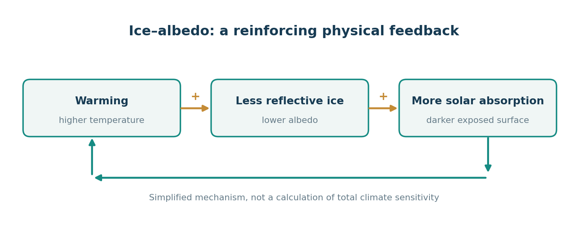

Земята е система за взаимодействие на атмосферата, океаните, сушата, леда и живите организми. Промяната в една част може да повлияе на друга и да се върне, за да засегне първоначалната промяна. Един от най-ясните примери за климата е обратната връзка с леда. Снегът и ледът отразяват повече слънчева светлина от по-тъмните океани или земните повърхности. Топлината може да намали снега или ледената покривка; откритите по-тъмни повърхности абсорбират повече слънчева енергия; това добавя затопляне, което може да допринесе за по-нататъшното топене. Въртележката се усилва в смисъла, определен по-рано.

Но обратната връзка с климата трябва да бъде поставена в рамките на по-широката физическа картина. Температурата на Земята също реагира на промени в входящи и изходящи лъчения, както и на много други обратна връзка. Според IPCC комбинираното въздействие на известните отзиви от облицовъчни материали увеличава отговора на затоплянето при принуждаване на хората, докато отделните откъси, включително различните ефекти върху облака, имат различни мащаби и неясноти. Опростената диаграма може да съобщи механизма, но не може да замени количествените наблюдения върху климата или физическия модел на климата.

Горите предлагат друг поучителен случай. Вегетацията влияе върху движението на водата, местния климат, стабилността на почвата и местообитанието. Промяната в земеползването може да промени тези взаимодействия, но посоката и силата зависят от региона, климата и вида растителност. Би било безотговорно да се намесят точния глобален ефект от изявлението, че повече дървета създават повече дъждове. Въпросът за научно полезните системи не е дали можем да начертаем цикъл, а колко силен е той, при какви условия и какви наблюдения могат да го разграничат от алтернативи?

Хората понякога погрешно четат подсилваща обратна връзка като доказателство, че катастрофата е гарантирана или балансираща обратна връзка като доказателство, че природата ще се спаси. Нито едното, нито другото. Физически ограничения, взаимодействащи кръгове, регионални различия, човешки отговори и дълго време забавят материята. Системното мислене помага да се организират механизмите; измерване и тествана физическа теория определят колко уверено можем да ги количествено.

<figure class="figure" id="figure-7-6">

<figcaption>Фигура 7.6. Долната ледена покривка намалява отражението и може да усили затоплянето; фигурата пропуска други климатични процеси. <a class="figure-anchor" href="#figure-7-6" aria-label="Link to this figure">#</a></figcaption>
</figure>
