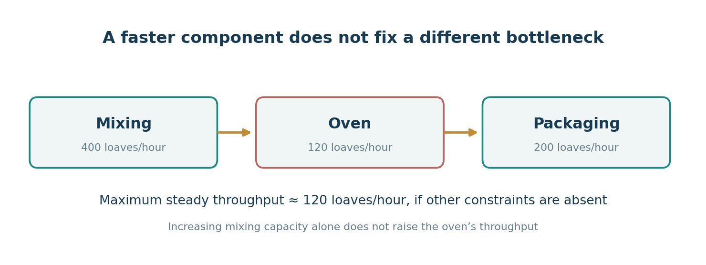

Мрежата съдържа възли и връзки: летища и маршрути за полети, уебсайтове и връзки, банки и плащания, фирми и доставчици, хора и взаимоотношения. Мрежите позволяват ресурси и информация да се движат, но топологията им влияе на нещата, които могат да се объркат. Голям порт, мост, център за данни или електрически трансформатор може да свърже много други отделни дейности. Когато се провали, смущенията могат да стигнат далеч отвъд първоначалното място.

Изпълнението на дадена мрежа може да зависи повече от нейния shortneck, отколкото от средния ѝ компонент. Представете си пекарна, която може да смесва тестото за 400 хляба на час, пече само 120 и пакет 200. При постоянна работа фурната ограничава общата мощност до около 120 хляба на час, при условие че други стъпки не налагат допълнителни ограничения. Наемането на повече миксери за тесто няма да повиши пропуска над лимита на фурната. Правилното подобрение е да се тества ограничението и целия работен процес, преди да се инвестира.

Има размяна между концентрацията и съкращенията. Разширяването на целия транспорт през един възел може да бъде ефективно при нормални условия, но разбивката може да засегне цялата мрежа. Разпространяването на трафика между няколко маршрута може да осигури устойчивост при допълнителни разходи. Някои съкращения са вградени в националните електрически мрежи, комуникационните мрежи и аварийните системи поради тази причина. Но само дублирането не гарантира безопасността, ако всички резервни пътища зависят от едно и също уязвимо енергийно или регулаторно решение.

Мрежовите ефекти могат да бъдат благоприятни, както и опасни. Споделеният железопътен стандарт позволява свързване на повече хора и товари; общите протоколи позволяват на компютрите да обменят информация. Понякога добавянето на линк подобрява достъпа, но в егоистично пренасочени трафик мрежи новодостъпен път може при определени условия да се влоши цялостното пътуване пъти на една идея, известна като парадокс Braess. Това е математическа възможност с конкретни предположения, а не твърдение, че изграждането на пътища обикновено прави трафика по-лош. Напомня ни, че въздействието на връзката зависи от това как потребителите се адаптират към нея.

<figure class="figure" id="figure-7-5">

<figcaption>Фигура 7.5. Провеждането на поредица от операции не може да надвишава най-бавния ограничаващ етап. <a class="figure-anchor" href="#figure-7-5" aria-label="Link to this figure">#</a></figcaption>
</figure>
