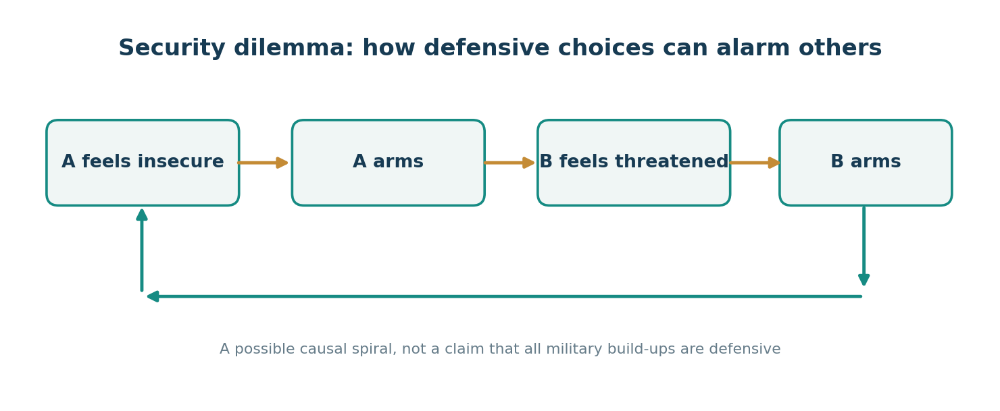

Системното мислене става особено важно, когато актьорите реагират един на друг. Представи си две съседни състояния, които не си вярват напълно. Щат А си купува защитно оборудване, за да се защити. Държавата Б отбелязва натрупването, но не може да бъде сигурна дали оборудването е чисто отбранително; В увеличава собствените си сили. А тълкува отговора на Б като доказателство за опасност и отново увеличава силите си. Всяка държава може да търси сигурност, но взаимодействието може да намали взаимното доверие и да увеличи разходите или рисковете.

Това е дилемата на сигурността, развита в международната стипендия и анализирана влиятелно от Робърт Джервис. Концепцията не оправдава агресията и не твърди, че всички военни струпвания са невинни. Държавите се различават по намерения, възможности и избор; някои се стремят към териториално завоевание, докато други търсят възпиране или защита. Дилемата е най-силна, когато намеренията са трудни за проверка и нападателните и отбранителни способности са трудно различими. Географията, технологиите, комуникацията и надеждните ангажименти влияят върху това дали спиралата може да бъде избегната.

Помислете за обратната връзка внимателно: Несигурността на А → Военните приготовления на А → Възприеманата от Б заплаха → Подготовката на Б → Несигурността на А. Разчупването на спиралата може да включва прозрачност, инспекции, защитни пози, които са по-лесни за разпознаване, споразумения, комуникация и институции. Но тези мерки са изправени пред проблеми на доверие и принудително изпълнение. В някои ситуации правдоподобното възпиране сам по себе си е важна част от стабилността. Един сериозен разказ трябва да разгледа контекста, вместо да настоява, че или повече въоръжение или едностранно разоръжаване автоматично решава проблема.

Историческите разкази често описват войни, като назовават предизвикателно събитие: покушение, инвазия, спорни избори или дипломатически ултиматум. Спусъците са от значение, но действат в рамките на структури от съюзи, военни планове, вътрешна политика, промени в властта и очаквания. Системното мислене може да помогне за идентифицирането на тези взаимодействащи каузи, без да превръща историята в машина, която неизбежно създава война. Човешките решения и отговорности не изчезват само защото решенията се случват в една система.

<figure class="figure" id="figure-7-8">

<figcaption>Фигура 7.8. Една илюстративна взаимно-заплаха спирала показва защо намеренията и възприятията имат значение в международните отношения. <a class="figure-anchor" href="#figure-7-8" aria-label="Link to this figure">#</a></figcaption>
</figure>
