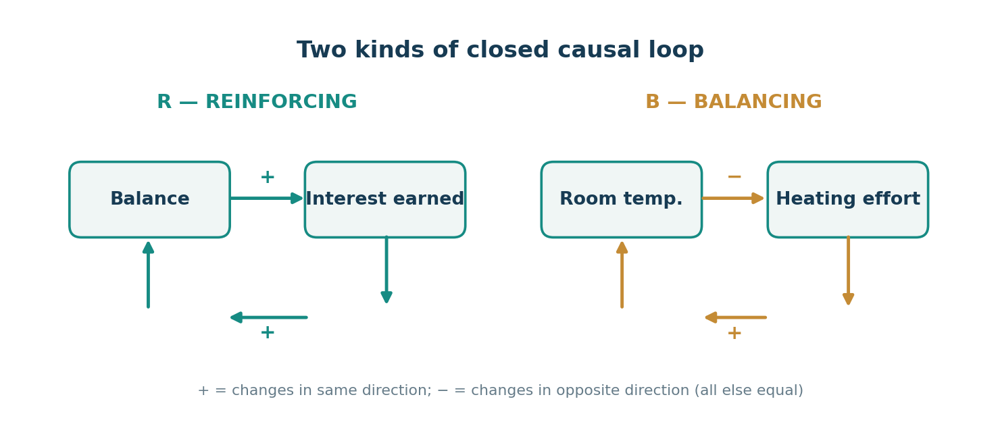

Обратна връзка съществува, когато промяната в системата в крайна сметка влияе върху условията, които са я причинили. Засилващ цикъл, традиционно маркиран R, усилва движението. Ако нещо расте, цикълът може да го накара да расте по-бързо; ако се свие, същият цикъл може да ускори спада. Подсилването е описание на посоката на цикъла, а не морална преценка, че цикълът е добър.

Един ясен пример е лихвата, която се събира в спестовна сметка. По-голям баланс печели повече лихви; по-голяма лихва увеличава баланса; че увеличаването на баланса печели още повече интерес. При постоянен положителен лихвен процент и липса на тегления този процес може да генерира експоненциален растеж. Един успешен пазар може да има друг механизъм за укрепване: повече купувачи привличат повече продавачи, а повече продавачи правят пазара привлекателен за купувачите. Тези ефекти не са неизбежни; задръстванията, разходите, конкуренцията и ограниченото търсене в крайна сметка могат да им противодействат.

Има и разрушителни усилващи кръгове. При илюстративен цикъл на ерозия на почвата загубата на растителност може да изложи почвата на ерозия; загубата на почва прави растежа по-труден; по-слабата растителност може да разкрие още повече почва. При финансова паника тегленията могат да убедят наблюдателите, че банката е опасна, мотивирайки допълнителни изтегляния. Силата на такива цикли зависи от конкретните условия; не всеки страх се превръща в банково управление и институции като депозитната застраховка могат да променят стимулите.

Не допускайте, че усилващите се кръгове могат да продължат без ограничение. Истинските системи се сблъскват с ограничения на ресурсите, промяна на поведението, регулиране, технологична адаптация и други обратна връзка. Разрастващите се градове се нуждаят от жилищно настаняване и инфраструктура; населението е изправено пред динамиката на раждането и смъртта; предприятията са изправени пред конкуренти. Неконтролираният модел за подсилване може да бъде полезен за разбиране на ранните бързи промени и подвеждащи, ако бъдат продължени за неопределено време.

За да начертаете причинен цикъл, идентифицирайте променлива и ефекта от промяната. Ако увеличение на А има тенденция да се увеличи В, други неща са равни, етикет стрелка +. Ако повече от А има тенденция да намалява В, етикет −. Следвайте стрелите около затворена верига. Засилва се цикъл с дори брой отрицателни връзки; цикъл с нечетно число се балансира. Това правило е конвенция на диаграмите, а не доказателство за съществуването на посочените взаимоотношения. Винаги проверявайте дали заявените стрели имат смисъл в истинския случай.

<figure class="figure" id="figure-7-3">

<figcaption>Фигура 7.3. Усилването на веригите усилва промяната; балансирането на контурите противодейства на отклоненията от целта. <a class="figure-anchor" href="#figure-7-3" aria-label="Link to this figure">#</a></figcaption>
</figure>
