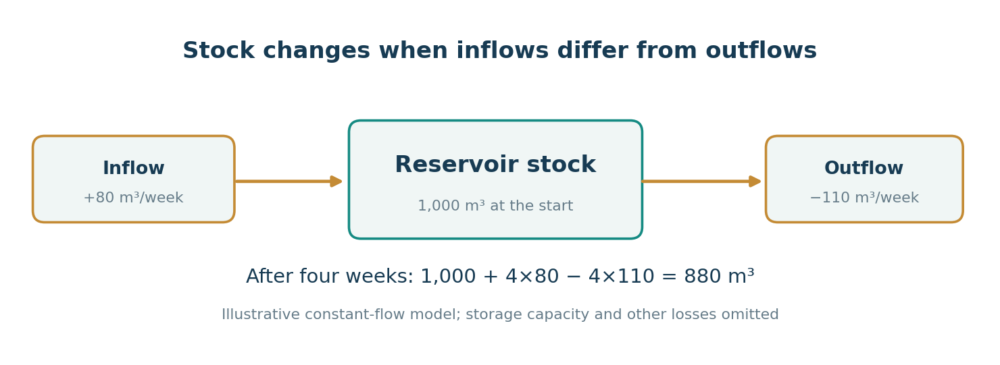

Акциите са нещо натрупано в даден момент: вода в резервоар, пари в банкова сметка, стоки на рафтове, въглероден диоксид в атмосферата, изключителен дълг, обучен персонал или хора, живеещи в град. Потокът е курс, който увеличава или намалява запасите: валежи и тегления, доходи и разходи, доставки и покупки, емисии и поглъщания, заеми и погасяване, наемане и отпътуване, раждания и смъртни случаи.

Това е основната счетоводна идентичност на обикновен език: следващият запас = текущата наличност + входящите потоци през периода − изходящите потоци през периода. По-сложните модели добавят загуби, трансфери и подробности за измерването, но счетоводният принцип остава. Потокът има единици на време; запасът не. Объркването на двете е основен източник на недоразумения в икономиката и обществения дебат.

Да разгледаме един измислен резервоар, съдържащ 1000 единици вода. Тя печели 80 единици всяка седмица от валежи и губи 110 чрез напояване и изпарение. След една седмица тя съдържа 970 единици. След четири седмици при тези непроменени ставки, тя съдържа 880. Дори дъждът да изглежда впечатляващо, резервоарът продължава да се свива, защото общите изходящи потоци надвишават общите входящи потоци. Питайки само колко дъжд е паднал пропуска състоянието на запаса.

Сега да предположим, че магазин започва с 300 единици инвентар, получава 70 на ден и продава 90 на ден. След пет дни инвентарът ще бъде 200, ако приемем без разваляне и никакви допълнителни промени. Продажбата на повече единици е добра за приходите в краткосрочен план, но ако попълването е последователно по-бавно, високите продажби в крайна сметка създават празни рафтове. Мениджър, който празнува само потока на продажбите, може да не успее да признае намаляващата инвентаризация, докато клиентите не се оплачат.

Има решаващ нюанс: запасите не винаги са осезаеми. Доверието между общностите, организационните знания, плодородието на почвата и доверието в институциите може да се натрупа или да се влоши, въпреки че измерването им е по-трудно от броенето на консерви в склад. Не е извинение да се преструваш, че имаш точен номер. Можем да идентифицираме механизми и да използваме индикатори, докато оставаме откровени относно несигурността.

<figure class="figure" id="figure-7-2">

<figcaption>Фигура 7.2. Съкращенията се променят, когато входящите и изходящите лихвени проценти се различават; илюстративно изчисляване на постоянния поток. <a class="figure-anchor" href="#figure-7-2" aria-label="Link to this figure">#</a></figcaption>
</figure>
