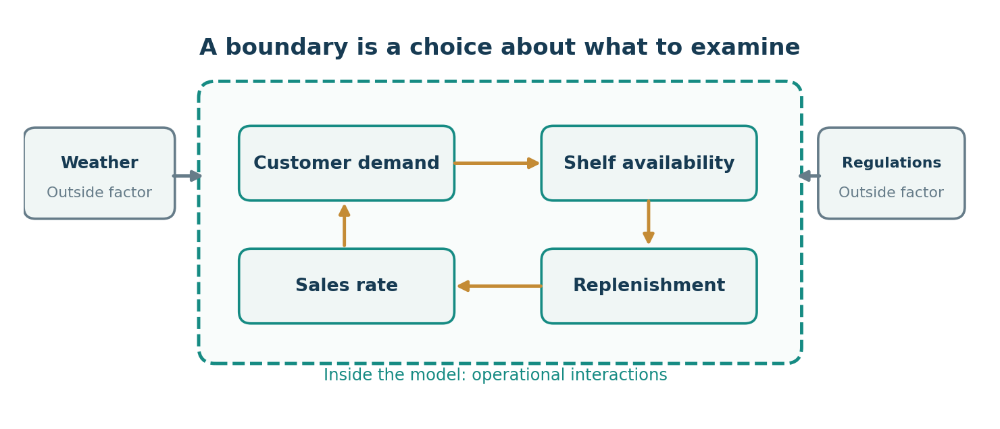

Системата се състои от елементи, чиито взаимоотношения и взаимодействия създават разпознаваем модел на поведение с течение на времето. Елементите може да са хора, институции, машини, видове, пари, информация или физически материали. Взаимодействието може да включва обмен на енергия, ресурси, сигнали, авторитет или очаквания. Системите често имат цел или функция, въпреки че една екологична система не се нуждае от съзнателен дизайнер и заявената цел на политическата система може да се различава от резултатите, които тя всъщност възнаграждава.

Един велосипед е полезен механичен пример: колела, верига, педали и спирачки материя поради начина, по който те си взаимодействат. Болницата е по-трудна. Тя включва пациенти, работници, доставки, легла, графици, информационни системи, регулации и обществени очаквания. Ако една болница купува повече легла, но не увеличава броя на квалифицирания персонал, способността му да лекува пациенти може да се промени малко. Леглата са компоненти; персоналът, потокът на пациентите и координацията помагат да се определи ефективният капацитет.

Критичният избор е къде да начертаем границите на системата. Да разгледаме трафика по един път. Можете да изучавате кръстовищата, сигналите и ограниченията на скоростта. Но ако шофьорите се движат по съседни улици, когато пътят стане претъпкан, тези улици също принадлежат на модела. Разширете границата, за да включите модели на пътуване, паркинг цени и обществен транспорт, и може да откриете, че привидно местен проблем претоварване е отчасти причинено от решения за използване на земята, взети години по-рано. Никоя граница не е уникално правилна: една добра граница включва актьорите и процесите, необходими за обяснение на въпроса, като се изключват детайлите, които добавят малко разбиране.

Системата също се намира в по-голяма среда. Времето засяга системите за отглеждане на култури; търговската политика засяга супермаркетите; пандемията засяга училищата и болниците. Моделът е целенасочено опростяване, а не миниатюрно копие на вселената. Винаги питайте: Кои променливи сме включили? Кои актьори липсват? Какво се предполага, че остава постоянно? През кой период се интересуваме от резултата?

Важното разграничение е сложно срещу сложно. Самолетният двигател може да бъде изключително сложен, но много от компонентите му се държат предсказуемо при определени условия. Градът е сложен отчасти, защото хората се адаптират един към друг. Правило, предназначено да промени едно поведение, може да промени стимулите и да създаде ново поведение, което никога не е присъствало в първоначалния план. Няма перфектна разделителна линия, но разликата ни напомня, че по-подробните инструкции не винаги правят социалната система по-лесна за контрол.

<figure class="figure" id="figure-7-1">

<figcaption>Фигура 7.1. Полезната граница улавя механизми, свързани с въпрос, докато признава влиянието извън него. <a class="figure-anchor" href="#figure-7-1" aria-label="Link to this figure">#</a></figcaption>
</figure>
