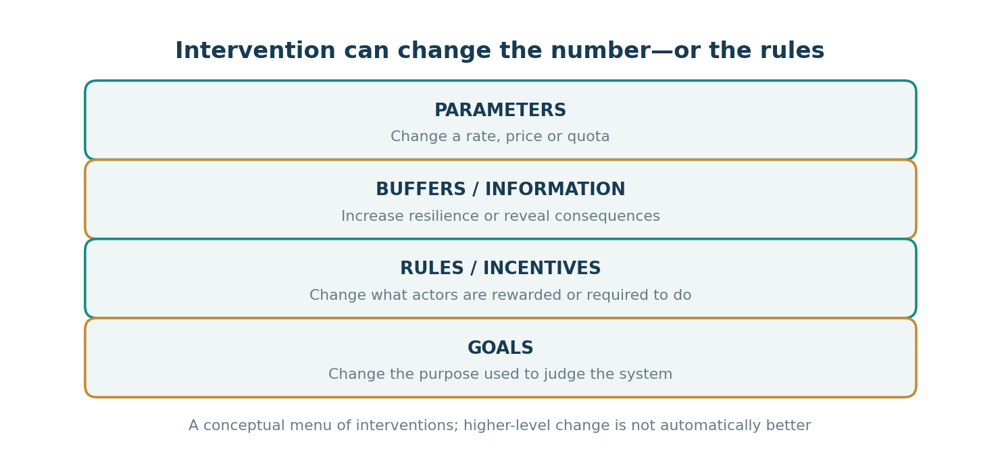

Донела Медоус предложи йерархия от точки на лоста, места в система, където намесата може да промени поведението. Широкото прозрение е, че промяната на основното правило, цел или информационен поток може да има по-голямо въздействие от многократното коригиране на числен параметър. Това е рамка за мислене, а не гарантирано класиране на интервенциите във всеки случай. Една проста промяна в параметър може да бъде от жизненоважно значение при извънредна ситуация; промяната на целта на институцията може да бъде политически трудна или да доведе до нежелани странични ефекти.

Върни се в град с многократно недостиг на вода. Смяна на параметрите: да се повиши границата за аварийно разпределение на резервоара. Сменяне на буфера: добавяне на съхранение. Промяна на информацията: публикува изтичане в реално време и използване на данни. Промяна на правилото: изискват ремонти, ценови реформи или ограничения за използване. Целева промяна: преминаване от максимизиране на годишния обем на доставките към поддържане на надеждно обслужване и дългосрочно здраве на водния слой. Всеки действа в различна част на системата. Никой не трябва да бъде избиран без доказателства за разходи, права, поведение и местни условия.

Да разгледаме четири полезни въпроса, когато се предлага намеса. Отърва ли се от шишето? Новият закон може да се провали, ако силите за изпълнение липсват. Съкращава ли вредно забавяне? Ранното предупреждение помага, ако вземащите решения могат да действат. Променя ли стимулите? Прозрачността може да има значение само когато някой има причина и способност да реагира. Това променя ли предназначението на системата? Институцията, оптимизирана за намаляване на разходите, може да предостави различни резултати от изрично оценените по отношение на достъпа, безопасността и дългосрочните резултати.

Това дава възможност на системите да мислят за практическата си сила. Той ви кани да различите симптомите от структурите, докато си спомняте, че симптомите все още се нуждаят от незабавна грижа. Ако хората са гладни, това не е от значение само защото селскостопанската политика се нуждае от реформи. Ако мостът е опасен, затварянето може да бъде необходимо дори когато дългосрочното решение включва бюджети за поддръжка и управление на инфраструктурата.

<figure class="figure" id="figure-7-9">

<figcaption>Фигура 7.9. Интервенциите могат да променят параметрите, буферите, информацията, правилата и целите; няма повсеместно най-добър избор. <a class="figure-anchor" href="#figure-7-9" aria-label="Link to this figure">#</a></figcaption>
</figure>
