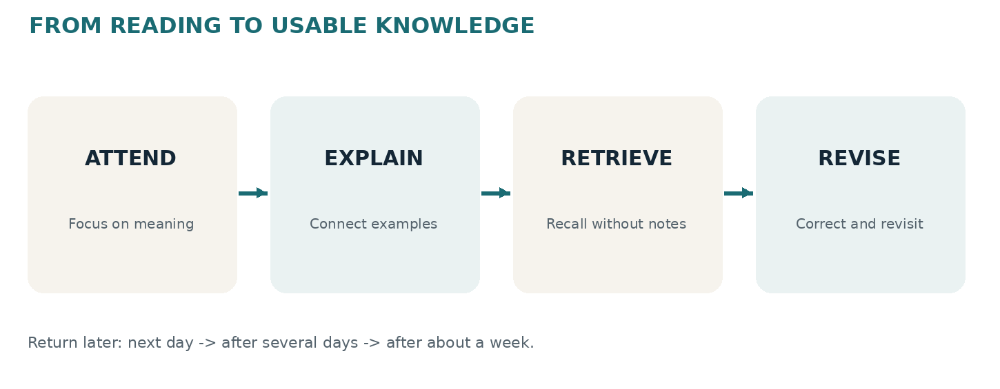

След няколко четения един абзац ми изглежда познат. Може да почувстваш, че можеш да го обясниш. Но запознанството може да се генерира чрез многократно излагане, и тя не винаги предвижда успешно отзоваване една седмица по-късно. Осветяването на изречения и копирането на пасажи може да ви помогне да намерите ключови материали или да организирате бележки, но нито надеждно гарантира трайно учене, когато се използва само.

<strong>Упражнение по извличане</strong> е по-взискателна алтернатива: затворете книгата и се опитайте да възпроизвеждате основните идеи от паметта. Запитай се какво е причинило едно събитие, как една концепция се различава от друга или какви са частите на спора. Тогава провери отговора си. Дори един неуспешен опит може да помогне, когато са последвани от корективна обратна връзка, при условие че опитът е продуктивен, а не разочароващ догадъчен маратон.

Вместо да препрочитаме цяла секция за проекциите на картата, попитайте: "Защо една плоска карта не може да запази областта и формата навсякъде? За какво е особено полезен Mercator? Защо Гренландия може да изглежда твърде голяма?" Ако можете да отговорите без текста, репетирате реалното умение, което искате по-късно: извличане на информация, когато някой ви зададе въпрос.

Възстановяването трябва да бъде трудно, но постижимо. Ако една глава е напълно непозната, имате нужда от първоначално обяснение и примери преди тестване. Ако не можете да си спомните нищо, прегледайте малка реплика или част от отговора и опитайте отново. Методът не е полезен само защото се чувства труден. Произволно предизвикателство, обратна връзка и подходяща задача.

<figure class="figure" id="figure-8-1">

<figcaption>Фигура 8.1. Повторим път от първото излагане на използваемо разбиране. <a class="figure-anchor" href="#figure-8-1" aria-label="Link to this figure">#</a></figcaption>
</figure>
