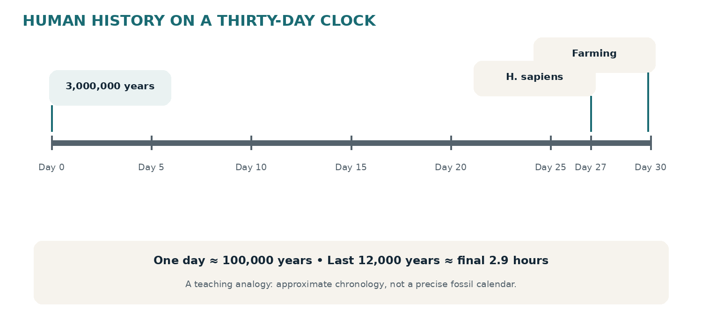

<figure class="figure" id="figure-9-5">

<figcaption>Фигура 9.5. Три милиона години компресирани в 30-дневен мисловен експеримент. <a class="figure-anchor" href="#figure-9-5" aria-label="Link to this figure">#</a></figcaption>
</figure>

Постави собствения си живот до тези дати. Писмените записи заемат само една много кратка част от човешката история. Фермата заема по-дълга, но все още сравнително кратка част. Нашият вид съществува от стотици хиляди години. Хоминините съществуват за милиони. Появата на човешкото поведение се е разпространила през огромни периоди, които никой живот не би могъл да види.

Ето едно полезно упражнение в мащаб. Представете си, че три милиона години са били компресирани в един 30-дневен месец. Всеки ден би представлявал 100 000 години. Приблизителната история на нашия вид ще заема само последните три дни. Последните 12,000 години ще бъдат около 2,9 часа в края на месеца. Ако писането е започнало преди около пет хиляди години в някои региони, историята му ще заема около 72 минути. Това са илюстративни пропорционални преобразувания, а не точни дати за единен световен преход. Те показват защо историята започва с крале и войни оставя почти цялата човешка история навън.

Най-добрата рамка е да запомним няколко котви и техните последици, а не да натъпчем всяка конкурентна вкаменелост. Ходенето на два крака предшестваше нашия вид с милиони години. Инструментите са направени преди нашият род да бъде напълно установен. По-рано хоминините са пътували отвъд Африка много преди съвременните хора да го направят. Нашият вид еволюирал в Африка преди стотици хиляди години. Съвременната човешка експанзия доведе до срещи и генетично смесване. Човешкото селище на континенти се разпростряло през дълги и неравни периоди. Фермерството в крайна сметка трансформира връзката между общностите и земята, но тя дойде късно.
