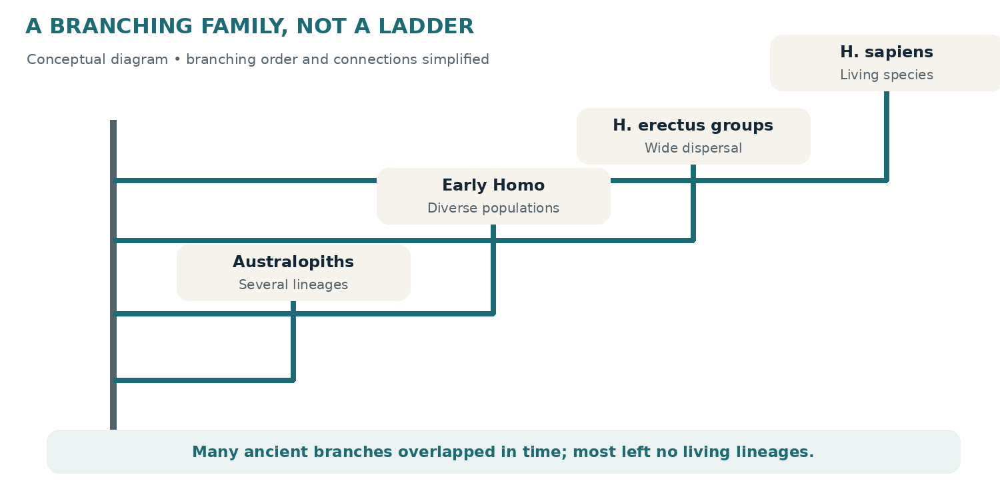

Най-ранните няколко милиона години от нашия клон са предимно африканска история. Вкаменелостите за хоминини са от Африка преди около 6 до 2 милиона години. Това не е така, защото другите континенти са маловажни за по-късната еволюция, а защото наличните данни сочат африкански произход и дълго развитие там преди членовете на рода Хомо да се разпространяват широко в Евразия. \[<a href="/009-human-evolution-and-the-first-migrations/sources/#source-2" class="cite">2</a>\]

Африка никога не е била една непроменяща се среда. През огромни периоди от време валежите се променяли; горите се разширявали или свивали; пасищата се разпространявали в някои региони; езерата се образували и изсушавали; вулканичната активност заравяла следи от живот; а животинските общности се променяли. Различни среди предлагат различни ресурси и натиск. Изследователите изследват фосилизиран прашец, животински зъби, седиментни слоеве, изотопи и геология на ландшафта, за да възстановят тези условия. Дори и след това трябва да се противопоставим на чистата история, че гората е изчезнала, така че хората се изправили. Право ходене има сложна история и може да са предложили различни предимства при различни условия.

Особено разкриващото откритие идва от Лаетоли. Отпечатъците показват, че двукраката ходеща способност да се движиш на два крака е установена много преди появата на нашия вид. Бипедализмът не е мигновено изобретение: ранните хоминини комбинирани черти полезни за ходене с други, които помогнаха в катеренето. Учените изследват таза, коляното, глезена, гръбначния стълб и големия пръст, за да разберат как различните видове се движат. Един единствен вкаменелост може да не запази всички тези характеристики, което е друга причина реконструкциите да са предпазливи. \[<a href="/009-human-evolution-and-the-first-migrations/sources/#source-1" class="cite">1</a>\]

Един известен вид е Australopithecus afarensis, известен от източноафрикански вкаменелости, датирани общо между преди около 3,9 и 2,9 милиона години. Частичният скелет, наречен Люси, намерена в Етиопия през 1974 г., помогна на изследователите да разберат тяло, което е способно да ходи изправен, но се различава по много начини от нашите. Луси не е била буквално "първият човек," нито можем уверено да я идентифицираме като нечий пряк предшественик. Тя е доказателство за население близо до важни клони в семейното дърво. Индивидуалната вкаменелост е прозорец, а не пълно родословие.

Други australopiths и свързани хоминини живеят в различни региони и периоди. Някои от тях имаха здрави структури за дъвчене, други - различни пропорции на тялото или зъбни модели. Тъй като вкаменелостите са редки и неравномерно запазени, признатото семейно дърво се променя, както се натрупват находките. Да се каже, че ранната човешка история е "сложна" не е избягване на отговора. Тя съобщава какво се случва, когато няколко свързани линии съществуват едновременно и доказателствата ги свързват несъвършено.

Появата на рода Хомо не заменя незабавно всички по-стари форми. Ранните популации на хомо се припокриват с астралопит или други хомининови популации. Етикети като Homo habilis и Homo rudolfensis помагат да се организират вкаменелости, но точните граници и взаимоотношения остават дискутирани. Семейното дърво е най-добре си представя като храст: клони, които се разделят, припокриват във времето, понякога изчезват и не оставят задължително вкаменелости във всяка вилица.

<figure class="figure" id="figure-9-1">

<figcaption>Фигура 9.1. Концептуално напомняне, че древните човешки роднини образували припокриващи се клони; а не буквално семейно дърво. <a class="figure-anchor" href="#figure-9-1" aria-label="Link to this figure">#</a></figcaption>
</figure>
