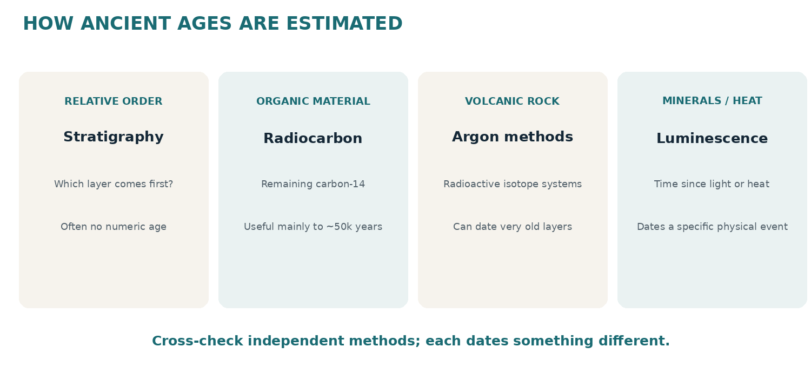

Вкаменелост няма етикет, който да обявява датата си. Археолозите и геолозите създават възрасти чрез изучаване на физическия контекст и прилагане на няколко метода, всеки със свои собствени предположения. Това заслужава внимание, защото датата често е пантата, на която се обръща сметка за произхода. Разликата между находка, датираща преди 45 000 години, и такава с дата до 70 000, може да промени целите модели на миграция. Грандиозните заглавия са изградени върху техническа работа, която читателите рядко виждат.

<strong>Стратиграфия</strong> започва с слоеве. В една необезпокоявана седиментна последователност, по-ниските слоеве обикновено са по-стари от тези над тях. Това е относителна поръчка, а не автоматично числова дата. Погребването на животни, по - късно копаенето, ерозията, геоложкото движение и повторното поставяне може да наруши модела. Костта, лежаща близо до инструмент, не е непременно на същата възраст като инструмента. Археолозите записват точните позиции на артефактите и проучват дали те имат непокътнат слой.

<strong>Радиовъглеродна дата</strong> използва радиоактивния разпад на въглерод-14 в материал, който е живял веднъж. Когато един организъм умре, той спира редовно да обменя въглерод с околната среда и концентрацията му на въглерод-14 постепенно намалява. При подходящи условия останалата част може да помогне за оценка на възрастта. Методът е най-полезен за материали до около 50 000 години, въпреки че ефективната граница зависи от качеството на пробите и лабораторните условия. Замърсяването с по-скорошен въглерод може да накара древна проба да изглежда по-млада; "старият" въглерод във водните резервоари може да направи някои проби да изглеждат по-стари. Калибрирането е от съществено значение, тъй като атмосферните нива на въглерод-14 са варирали.

По-старите находки често изискват други техники. Калий-аргон и аргон-аргонови датиращи могат да датират вулканични материали, които могат да поставят ограничения върху вкаменелости или инструменти, вградени между датирани слоеве. Уранови серийни методи изследват радиоактивни процеси в подходящи залежи, включително някои пещерни образувания. Луминесценция запознанство може да се изчисли, когато минерални зърна са били последно изложени на слънчева светлина или отопление, и термолуминесценция може да помогне дата някои отопляеми артефакти. Всеки метод измерва конкретен физически процес, а не "ерата на всичко наблизо."

Най-силната археологическа хронология често съчетава независими подходи. Представете си стъпки в поредица от древни седименти на езерото. Изследователите могат да датират семена, земен прашец и минерали в слоевете, след което да попитат дали резултатите са съгласни с геологията и климатичните доказателства. Изследванията на Белите пясъци в Северна Америка илюстрират този подход: новите независими методи подкрепят възрастова оценка от около 21 000.23 000 години за човешки отпечатъци, което предизвиква по-стари предположения относно датите на уреждане. Значението се крие не само в една драматична дата, но и в това как учените тествали датата, след като били повдигнати възражения. \[<a href="/009-human-evolution-and-the-first-migrations/sources/#source-7" class="cite">7</a>\]

<figure class="figure" id="figure-9-2">

<figcaption>Фигура 9.2. Различни научни методи за запознанства ограничават различни събития или материали. <a class="figure-anchor" href="#figure-9-2" aria-label="Link to this figure">#</a></figcaption>
</figure>

Срещите остават упражнение по вероятност, а не мистична точност. В резултат на това 315,000 ± 34,000 години се изразява прогнозираната възраст и несигурност по определена техника. Това не означава, че изследовател е наблюдавал човек, живял точно преди 315,000 години. Дори когато най-добрата оценка е надеждна, методите могат да не са съгласни, защото те датират различни събития: производството на инструмент, погребението на кост, образуването на покриващ депозит или последното излагане на пясък на слънчева светлина.

<strong>Един полезен читателски въпрос:</strong> Когато в една статия се казва "най - старите човешки доказателства," попитай: кое е най - голямото? Най-старият вкаменелост, класифициран като нашия вид? Най-старият човешки семеен отпечатък? Най-старият каменен инструмент? Най-старата следа от живот на континент? Това са различни твърдения и разграничението пречи на много заблуждаващи разисквания.
