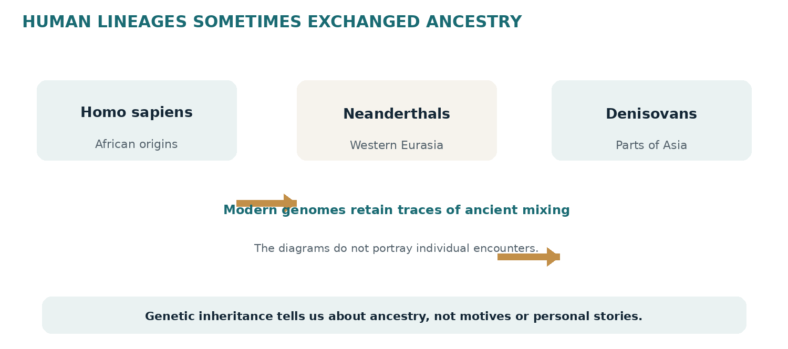

В продължение на поколения неандерталците били изобразени като сурови, брутални провали: паднали фигури, които не можели да съвпаднат с предполагаемия блясък на съвременните хора. Този стереотип е лоша наука и бедна история. Неандерталците били човешки роднини, които живеели в цяла Европа и части от западна Азия стотици хиляди години. Те имали големи мозъци спрямо размера на тялото, сложни каменни технологии и възможности за сложно поведение. Животът им варираше с региона и времето, както би се случило с всяко дълго живеено население. Те не бяха нито идентични с нас, нито просто карикатури. \[<a href="/009-human-evolution-and-the-first-migrations/sources/#source-9" class="cite">9</a>\]

Изчезването на неандерталците преди около 40 000 години остава активен обект на изследване. Колебанията в климата, малките и фрагментирани популации, конкуренцията, демографските процеси и взаимодействието с разширяването на населението на Хомо сапиенс може всички да имат значение. Няма научна заповед за лесен морален разказ, в който един вид "заслужен" да оцелее. Някои местни популации изчезват; други допринасят за генетичния материал на потомците чрез кръстосване. Границата между изчезването и предците е по-сложна от проста история за заместване.

Генетичната революция промени дебата. Древната ДНК, извлечена от човешки останки, може да бъде сравнена с ДНК от живи хора. За много хора, чиито предци до голяма степен са извън Африка, приблизително 1... 3% от геномите им произлизат от неандерталски предци, с различия в отделните индивиди и популации. Древните миграции обратно в Африка и други демографски процеси означават, че ДНК-то, получено от неандерталците, не е строго ограничено до неафрикански популации. Тези пропорции описват геномичното предшество, а не моралната или интелектуална стойност на човек. \[<a href="/009-human-evolution-and-the-first-migrations/sources/#source-10" class="cite">10</a>\]

ДНК също така разкри група, наречена "Денисован," която за първи път е призната чрез генетични доказателства от оскъдни останки в Сибир. Последвалите вкаменелости и генетични улики сочат към по-разнообразна история в Азия. Свързаното с Денисован предшество допринася за някои съвременни популации, особено в части от Океания и Азия, а генетичните модели показват, че смесването се е случвало повече от веднъж. Самите открития на Денисовани показват как огромната история на населението може да остане почти невидима, когато вкаменелостите са оскъдни. \[<a href="/009-human-evolution-and-the-first-migrations/sources/#source-10" class="cite">10</a>\]

Геномният анализ от 2024 г. на древните съвременни хора показва, че значителен епизод от неандерталската смес, споделян сред много наши неафрикански родове, се е появил преди около 45 000 и 49 000 години. Това не е твърдение, че всички човешки-неандерталски контакт се е появил в един следобед или само веднъж. По-ранните взаимодействия също са доказани; оценките за смесване зависят от включените в извадката геноми и от въпросите, задавани по генетични въпроси. Напомня ни обаче, че генетичните данни могат да ограничат събитията далеч по-близо от карта само на разпръснати кости. \[<a href="/009-human-evolution-and-the-first-migrations/sources/#source-11" class="cite">11</a>\]

<figure class="figure" id="figure-9-3">

<figcaption>Фигура 9.3. Древните човешки популации се различават и понякога разменят предшественици; само схеми. <a class="figure-anchor" href="#figure-9-3" aria-label="Link to this figure">#</a></figcaption>
</figure>

## Защо думата "размножителство" има значение

Някои диаграми по учебник показват девствено дърво: един клон се отделя от друг и никога повече не докосва. Генетичните доказателства показват, че клоните в човешката история понякога се свързват отново. Предците, които са се разделили в продължение на много поколения, все още могат да имат деца заедно при някои обстоятелства. Потомците им носели наследени варианти. Подобно смесване не прави всички популации "един и същи вид" в проста таксономия, нито прави всяка древна среща позната. Казва ни, че модел само с чисти разцепвания пропуска истинска част от историята.

Също така трябва да избягваме романтични или сензационни древни срещи. ДНК може да разкрие споделени предшественици; тя не може да ни каже дали конкретна среща включва приятелство, принуда, размяна, семейни връзки или конфликт. Човешкият живот е по-богат от живия генетичен сигнал. Науката може да отговори на много въпроси, но има различни степени на достъп до различни видове опит.
