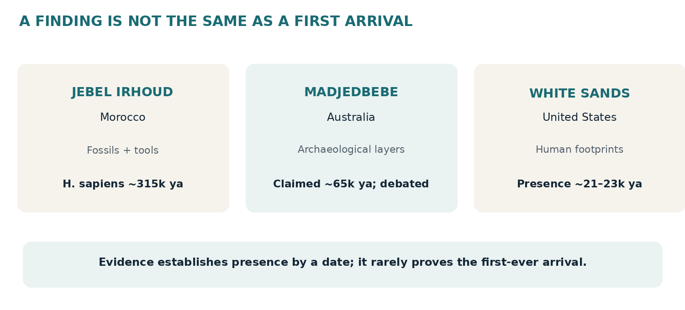

Америка формира особено поучителен случай, защото най-известната история на учебника се е променила драстично. През по - голямата част от двадесети век разказите често свързвали най - ранното селище в близост до традициите на каменоделния камък Кловис, датирани преди около 13 000 години. Идеята за "Кловис първо" в крайна сметка била изправена пред убедителни доказателства за по-стари професии. Изследванията продължават да се връщат назад към правдоподобните дати, да преразгледат маршрутите и да покажат колко трудно е да се докаже абсолютното първо пристигане.

По време на студените периоди по - ниското морско равнище изложило Берингия, широк регион, който се присъединил към това, което сега е североизточна Азия и Северозападна Северна Америка. Но преминаването през Берингия не би гарантирало влизане във всички части на континента. Ледените листове могат да блокират вътрешните проходи и съществуването на коридор без лед на една дата не доказва, че той може да подкрепи човешка миграция тогава. Един тихоокеански крайбрежен маршрут е един правдоподобен път; някои ранни крайбрежни обекти сега могат да бъдат потопени, защото морските нива по-късно се повишиха. Доказателствата пасват на по-сложна картина от една линия хора маршируващи на юг между ледниците.

Едно откритие кристализира дебата. Изследователите са идентифицирали стъпки в Национален парк Уайт Сандс в Ню Мексико в древните залежи на езерото-марджин. Оценка на възрастта от 2021 г. показва, че отпечатъците са били преди около 21 000 и 23 000 години, много по-рано от класическата хронология на Кловис. Скептиците поставиха под въпрос дали радиовъглеродното датиране на водни семена може да бъде засегнато от резервоар със стар въглерод. По-късно изследвания датирани наземна цветен прашец и изследвани луминесценция в околните седименти; резултатите подкрепят по-стара оценка. А 2025 американски геологическо изследване синтез описва множество независими линии на доказателства за човешко присъствие по време на Last Glacial Максимум. \[<a href="/009-human-evolution-and-the-first-migrations/sources/#source-7" class="cite">7</a>\]

<figure class="figure" id="figure-9-4">

<figcaption>Фигура 9.4. Намерението установява местно присъствие до дата, а не точното време на първото пристигане. <a class="figure-anchor" href="#figure-9-4" aria-label="Link to this figure">#</a></figcaption>
</figure>

Това урежда ли всеки въпрос? Не. Тя засилва случая с човешкото присъствие в Белите пясъци през посочения период. Тя не разкрива езиците на хората, социалните взаимоотношения, точните предци или всички пътища, по които по-ранните популации са влезли в континента. Индивидуалните дати не реконструират автоматично процес на континентално уреждане. Нито пък ни казват, че всяка родова общност на по-късно коренно американско население произхожда от тази специфична група. Множество движения, регионална приемственост и по-късно промяна трябва да бъдат проучени чрез много линии на доказателства.

Това е важен урок за четене на археологически заглавия. Когато чуете, че "първите американци са били тук преди 23 000 години," един внимателен превод е: силни доказателства сочат, че някои хора са присъствали в една част на Северна Америка по това време. По-ранните пристигания остават възможни; датата не е биография на цял континент. От съществено значение е разграничението между най-ранните открити доказателства и най-ранното действително присъствие. Археологията работи с това, което оцелява и се намира, а не с всичко, което някога се е случило.
