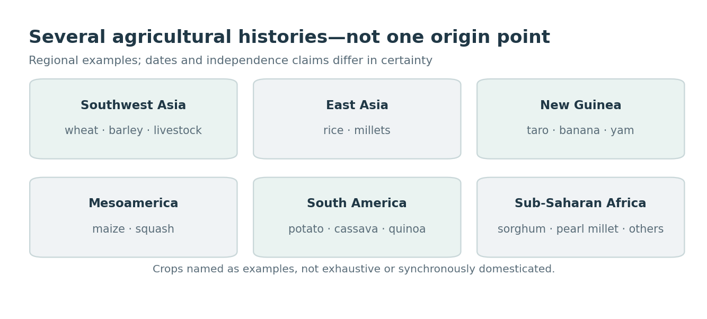

Селското стопанство в Африка също се появи през различни пътища. Различни зони, приети и разработени култури и стадо според техните екология. Североизточна Африка е имала дълги връзки с Югозападна Азия домашни любимци в някои области, докато други африкански региони са развили местни култури за домашно отглеждане, включително перлено просо, сорго и африкански ориз през различни истории. Техният точен произход и времева линия се различават и остават обект на археологически изследвания. \[<a href="/010-the-agricultural-revolution/sources/#source-2" class="cite">2</a>\]

Сахара е особено поучителна. Миналото му не беше еднакво като днешния сух пейзаж. По време на влажните периоди в ранния и средния холоцен, езерата, пасищата и водните пътища са подкрепяли разнообразни общности, включително популациите, ангажирани с управлението на животните. По-късно изсушаване на трансформирани маршрути, възможности за уреждане и поминък. Не трябва да предполагаме, че една суша е принудила всички африкански общности в една селскостопанска система. Хората реагираха по много начини, а датите и процесите варираха регионално.

В горската зона и през савана екологиите, зърното, което може да оцелее след валежите, става ценно. По-на юг различните екологични зони насърчиха други комбинации от култури, местни иновации и обмен. Истории за произхода на земеделието, основани единствено на плодородното полумесец неумишлено изтриване на голяма част от тази история. Световната сметка трябва да третира африканските знания и опитомяването като централно, а не като късно допълнение.

<figure class="figure" id="figure-10-3">

<figcaption>Фигура 10.3. Избрани региони и култури, свързани с различна история на ранното селско стопанство; не буквална карта или една дата. <a class="figure-anchor" href="#figure-10-3" aria-label="Link to this figure">#</a></figcaption>
</figure>
