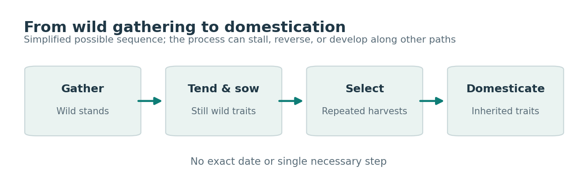

Три думи често се използват взаимозаменяемо: събиране, самоусъвършенстване и опитомяване. Те описват свързани, но различни процеси.

<em>Събиране</em> означава събиране на растения, които растат без непременно да се организира тяхното възпроизвеждане. Самоусъвършенстването означава активно отглеждане или засаждане на полезни растения, включително растения, които все още могат да бъдат биологично диви. Домакинството се отнася до еволюционни промени в растителните или животинските популации, причинени от трайни взаимоотношения с хората и околната среда с човешки образ. Домакинството може да отглежда диви растения. Тя може също така да получи напълно опитомени зърна чрез размяна, без да го отглежда. Земеделските системи са изградени от комбинации от практики, а не от магически праг.

Помисли за дива закуска. Когато узрее, главата на семето често става крехка и се разпада, разпространявайки семена в почвата. Това е изгодно за растението в дивата природа. Но за някой, който събира зърно, семената, които падат преди събирането, могат да означават изгубена храна. В продължение на много жътви някои растения запазват семената си по - дълго поради наследеното разнообразие. Ако хората преференциално се събират, носят, посяват и защитават тези растения, може да нарасне делът на образуващите семена форми. В крайна сметка култивираната популация може да стане все по - зависима от хората, за да разпръснат семената си.

Археологическата следа е малка: фрагменти от централната ос на зърнена глава, наречена рахи. Изследователите проучват как е разбила и определила пропорциите на формите "див тип" и "домашен тип." Това не е перфектен тест с едно зърно; вариацията, запазването и идентификацията могат да го усложнят. И все пак в много останки и добре датирани слоеве, тези малки фрагменти могат да картографират вековната човешка съвокупление. Изследванията показват, че няколко познати черти на опитомяването се появяват постепенно, а не в един кратък епизод. \[<a href="/010-the-agricultural-revolution/sources/#source-3" class="cite">3</a>\]\[<a href="/010-the-agricultural-revolution/sources/#source-4" class="cite">4</a>\]

Животинското опитомяване въвежда още един набор от връзки. Хората може първо да ловуват видове, по-късно да защитават или управляват движенията си и евентуално да размножат животни, чието размножаване и поведение са дълбоко оформени от хората. Най-ранните домашни любимци не всички изпълняват една и съща функция. Овцете и козите предлагаха месо и други ресурси; говедата можеха да осигуряват месо, а в по-късните селскостопански системи - тягови и млечни продукти; прасетата следваха различен екологичен и управленски път. Домашното животно не е просто опитомен индивид. Укротяването засяга поведението на едно животно; опитомяването описва трайна промяна в нивото на населението.

Това разграничение има значение, защото археологическият обект може да съдържа доказателства за един процес, без да доказва друг. Шлайфането на камъни показва преработка на храна, а не непременно земеделие. Животинските кости могат да показват лов, а не стадо. Съхраняваните семена могат да бъдат събрани диви храни. Силните интерпретации обикновено се основават на няколко улики: видов състав, растителна морфология, модели на убиване в животински стада, структури, инструменти, почвени смущения, генетика и регионални последователности.

<figure class="figure" id="figure-10-1">

<figcaption>Фигура 10.1. Опростена последователност: човешкото управление и наследените растителни черти могат да се променят заедно през поколенията. <a class="figure-anchor" href="#figure-10-1" aria-label="Link to this figure">#</a></figcaption>
</figure>
