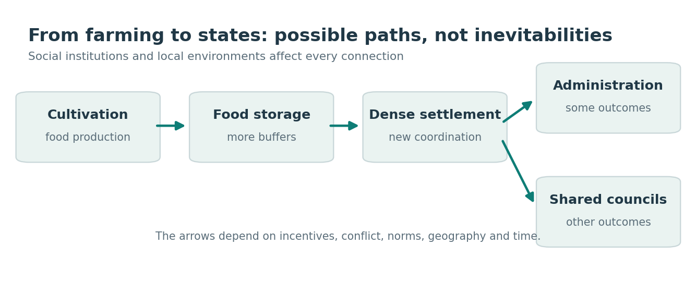

Когато някои домакинства произвеждат повече храна, отколкото те веднага консумират, други дейности могат да се разширят. Хората могат да прекарват повече време в правене на инструменти, изграждане на структури, участие в ритуали, обмен на стоки или управление на споделени ресурси. Но концепцията за излишъка е по-изтънчена от купчина резервни зърна. Храната трябва да бъде годна за консумация, здрава, транспортируема и социално достъпна. Сезонен излишък, който се разваля преди търговията, не е еквивалентен на надежден годишен поток от ресурси.

Специализацията също предшества селското стопанство. Форгарс прави сложни инструменти, орнаменти и изкуство, както и много поддържа обмен на дълги разстояния. Това, което все по-плътните земеделски селища биха могли да променят, беше мащабът и редовността на определени специализации и способността за поддържане на хората, концентрирани на едно място. Повече производители на храни на квадратен километър могат да подкрепят по-разнообразния труд, но споразумението зависи от производството, разпространението и институциите.

Следователно връзката между селското стопанство и държавите е непряка. Първите правителства не са произлезли само защото пшеницата е била измислена. Политическата власт може да се появи чрез комбинации от концентрация на населението, конфликт, отбрана, ритуална координация, напояване, търговия, съхранение, данъчно облагане и елитни стратегии. Някои земеделски общности остават относително децентрализирани за дълги периоди. Някои неземеделски общества формираха сложни политически организации. По-късно Месопотамия предоставя особено важен случай за това как селското стопанство, градовете, храмовете, администрацията и писането са свързани, но тези връзки са предмет на следващата глава, а не на първия момент на опитомяване.

<figure class="figure" id="figure-10-6">

<figcaption>Фигура 10.6. Селското стопанство създаде възможности за няколко форми на социална организация; държавното формиране не беше автоматично. <a class="figure-anchor" href="#figure-10-6" aria-label="Link to this figure">#</a></figcaption>
</figure>

Историята е по-лесна за разбиране като верига от условни възможности. Самоусъвършенстването може да увеличи продукцията от дадена област. По-надеждният резултат може да насърчи постоянното уреждане. Постоянното селище може да подпомогне по-плътните популации и сложния обмен. Тъмните мрежи могат да направят координацията ценна. Координацията може да бъде споделена, договорена или заловена от мощни групи. Нито една от тези стрели не работи без условия и едно общество може да поеме алтернативни пътища на всеки етап.
