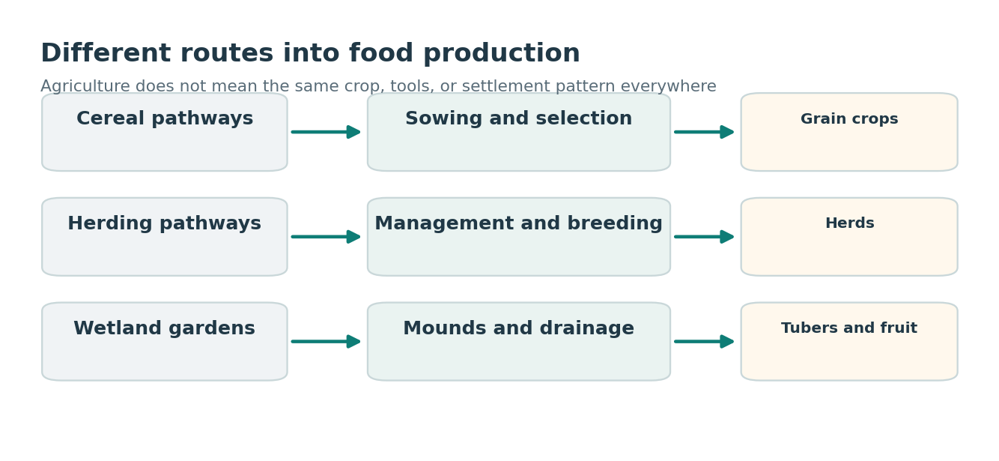

Житните култури изискват внимание в определени точки в сезонен цикъл. Животните добавят различен дневен ритъм. Стадото трябва да се наблюдава, полива, защитава, премества или ограничава. Управлението на популацията за разплод изисква решения кои животни се възпроизвеждат и кои биват заклани. Някои избори стават видими за археологията, защото структурите на стадото се различават от възрастта и сексуалните модели, които се очакват при селективния лов.

Едно стадо кози или овце може да превърне растителността, която хората не могат да смилат директно в храна и други материали. Стадите също могат да натрупат богатство в движение и да се превърнат в източник на социални задължения, булка, наследство и конфликт в общества, където тези институции съществуват. Но стадото си има цена. Животните консумират фураж и вода, могат да разпространяват патогени, и могат да се конкурират с полета за земя. Сушата или епидемията могат да унищожат години натрупани запаси.

Границата между земеделие и пасторализъм не е чиста. Хората могат да комбинират малък парцел зърно с сезонно движещо се стадо. Съседите могат да разменят зърнени култури за мляко, вълна или животни. По-късните търговски маршрути и политическите съюзи могат да зависят от тези допълващи се икономики. Трябва да не описваме мобилните говедари като някак "зад" установени фермери. Мобилността може да бъде най-разумната технология в страни, където валежите са несигурни, а тревата расте в големи сезонни диапазони.

Когато фермерите и пастирите се срещнаха, отношенията варираха от търговията и срочния брак до конкуренцията и насилието. По-късните глави ще изследват как тези взаимоотношения оформят империите и границите. Засега най-важното е, че опитомени животни направиха възможна нова форма на производство на храна, но не и универсален модел на селския живот.

<figure class="figure" id="figure-10-2">

<figcaption>Фигура 10.2. Различните пътища към производството на храни включват различни видове, пейзажи и форми на труд. <a class="figure-anchor" href="#figure-10-2" aria-label="Link to this figure">#</a></figcaption>
</figure>
