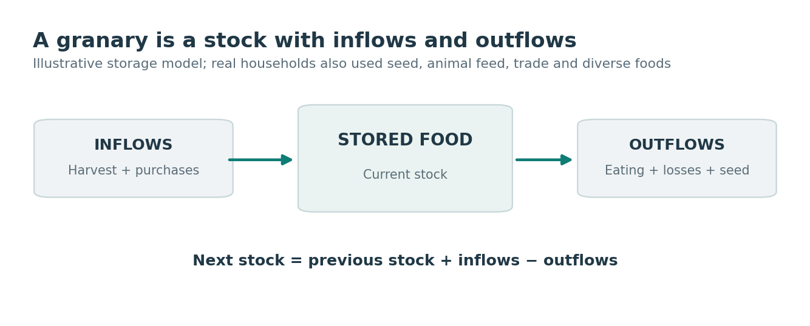

Може би най-важната земеделска сграда понякога не била дворец или храм, а склад. Полета произвеждат храна неравномерно през годината. Една успешна реколта може да се наложи да поддържа хората месеци преди следващата. Складът може да движи храната през времето. Тя създава и нов проблем: ценните концентрирани доставки трябва да бъдат защитени от влага, вредители, грабежи и кражби.

Представете си хипотетично семейство от пет, което планира да яде средно половин килограм съхранено зърно на човек всеки ден. Над 365 дни би изисквало 5 × 0.5 × 365 = 912.5 килограма ядливо зърно. Ако семейството очаква 20% от складираното зърно да бъде загубено, то трябва да започне с 912.5 0.8 = 1,14.625 килограма за тази конкретна употреба. Това е учение изчисление, а не възстановяване на древна диета: реални семейства консумират различни храни, засадени някои семена, търгувани, хранени животни и опитни променливи нива на загуба.

Защо е тази аритметика в учебника по история? Защото селското стопанство създаде връзка между жътва, население, риск и задължение, които могат да бъдат проучени количествено. По-голямата реколта не означава автоматично еднакво увеличение на излишъка, който може да се яде. Част от продукцията трябва да бъде запазена за семена, загуба на съхранение, обмен, религиозни приноси, храна за животни или други употреби. Трудът за изграждане на склад и сигурност също е разход.

Селото може да реши такива проблеми чрез домакински гранати, преразпределение на родството, общи депозити, реципрочен обмен или по-силни лидери, които организират и контролират резерви. Тези институции водят до различни политически последици. Споделен магазин може да осигури застраховка за глад; той също така може да създаде предимство за човека, който държи ключа. Затова археолозите проучват не само колко зърно е произведено, но и къде се намира складът и кой може да има достъп до него.

<figure class="figure" id="figure-10-5">

<figcaption>Фигура 10.5. Храната в склада е запас; прибирането на реколтата и яденето го променят във времето. <a class="figure-anchor" href="#figure-10-5" aria-label="Link to this figure">#</a></figcaption>
</figure>

Съхранението илюстрира общ принцип от глава 7. Натрупаната храна е запас. Жътвата, търговията и събирането са входящи потоци; яденето, развалянето, използването на семена и прехвърлянето са изходящи потоци. Ако сушата намали притока, съществуващият магазин може да ограничи шока. Но ако употребата на храна постоянно надвишава попълването, буферът в крайна сметка изчезва. В по-късните градове управлението на хранителните запаси ще бъде обвързано с данъчно облагане, записи, заплати и политическа легитимност.
