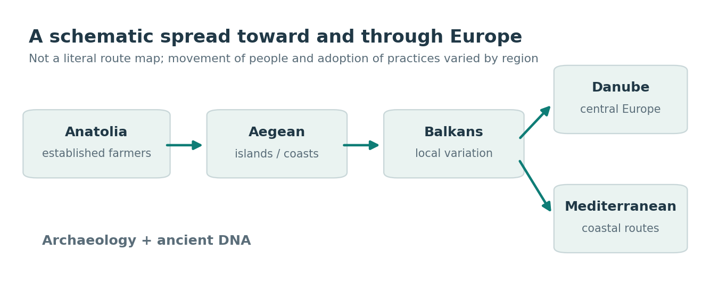

Земеделието в Европа не произхожда като копие, направено едновременно от всяка общност. Разпространяването му включваше миграции на хора, обмен на техники, сватосване, срещи със съществуващи търсачи и приспособяване към непознати климатични условия. Археологията и древната ДНК са направили едно особено ясно заключение: движението на земеделието в много европейски региони включваше значително движение на хора, свързани с ранното земеделие от Анадола и Егейско море, заедно с различни взаимодействия с установени ловци-събирачи. Това не заличи цялото местно разнообразие. \[<a href="/010-the-agricultural-revolution/sources/#source-11" class="cite">11</a>\]\[<a href="/010-the-agricultural-revolution/sources/#source-12" class="cite">12</a>\]

Около средата на седмото хилядолетие пр.н.е. земеделските общности са създадени в части от Егейско и Югоизточна Европа. От там се простират различни маршрути през балканския интериор, Дунавския басейн, Централна Европа и около Средиземно море. Тези маршрути помагат да се обясни защо ранните европейски селскостопански култури са се различавали в своите къщи, керамика, модели на уреждане и обменни мрежи, дори когато са споделяли важни култури и животни.

За територията на днешна България археологическият рекорд на Неолита и Медната епоха е особено богат. Общностите формират селища, развиват занаяти и управляват култивирани пейзажи много преди българска държава или нация в съвременния смисъл на думата. Грешка е да се проектират съвременни етнически етикети върху тези праисторически популации: хората, които са напуснали тези селища, не се наричат българи и техният език и идентичност не могат уверено да бъдат реконструирани от керамични форми или земеделски инструменти.

Няколко хилядолетия след като първите фермери достигнаха региона, гробището във Варна на Черноморското крайбрежие често датира от около 4600 и 4300 г. пр.н.е. Учените използват този материал, за да изследват диференциацията на богатството и социалната организация. Но Варна не е била автоматичен или незабавен резултат от първото засяване на зърно. Намесени бяха много културни, икономически и политически събития. \[<a href="/010-the-agricultural-revolution/sources/#source-13" class="cite">13</a>\]

Това ни дава полезна регионална последователност: ранно производство на храни в Егейско море и Балканите; растеж и обмен на селище; по-късни занаятчийски и металобработващи мрежи; и в някои контексти, забележителни доказателства за стратификация. Последователността не е идентична с историята на всяко село, а гробовете показват избрани символични избори, вместо пълна домашна книга за богатство. Въпреки това доказателствата показват защо Югоизточна Европа е от съществено значение за всяко глобално проучване на селското стопанство, а не просто проход към Западна Европа.

<figure class="figure" id="figure-10-4">

<figcaption>Фигура 10.4. Приблизителна схема на движения и контакти от Анадола и Егейско море към Европа. <a class="figure-anchor" href="#figure-10-4" aria-label="Link to this figure">#</a></figcaption>
</figure>
