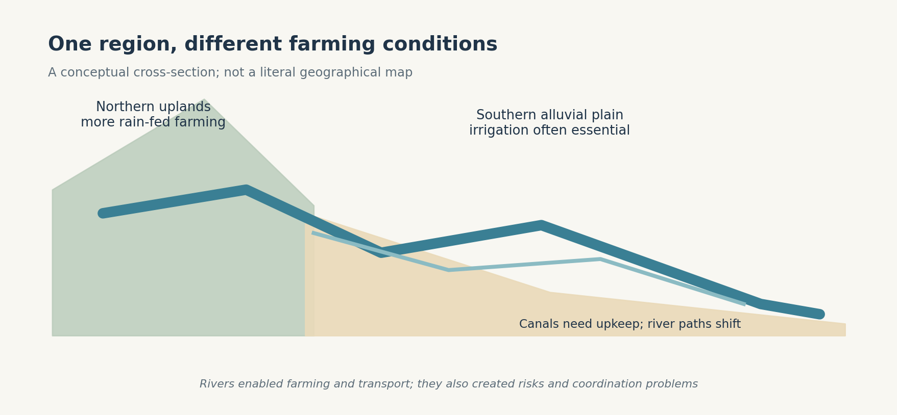

<em>Месопотамия</em> е гръцко наименование, традиционно преведено като земя между реките. Двете големи реки са Тигър и Ефрат. Днес техните долини преминават през части от Турция, Сирия и Ирак; връзките на историческия регион стигнаха много по-далеч. В някои области Северна Месопотамия имаше повече възможности за селско стопанство, хранено с дъжд. По-на юг, на широката алувиална равнина, валежите обикновено са били твърде ненадеждни за широко земеделие без внимателно управление на водата. Хората използваха речни канали, влажни зони, сезонни наводнения, канали и полета близо до променящите се водни пътища. \[<a href="/011-mesopotamia-and-the-first-states/sources/#source-3" class="cite">3</a>\]

Наричането на обикновен "фертилен" може да създаде илюзия. Почвата била продуктивна при подходящи условия, но едно поле не можело да отглежда ечемик само защото наблизо има река. Водата трябва да пристигне на точното място и време; каналът може да се пълни с утайка; потопът може да дойде непредсказуемо; каналът може да се промени; солта може да се натрупа при някои напоителни режими. Общество, което отглежда зърно в тази равнина, се нуждае от практически познания за градиенти, земни работи, сезони, съхранение и спорове относно достъпа. Географията създава възможности, а не инструкции за измисляне на крале.

Реките също били пътища. Лодките можели да носят масивно зърно, тръстики, дървен материал и други стоки по - икономично по плавателните пътища, отколкото хората можели да ги теглят през сушата. Блатото доставяло риба и тръстики; глината доставяла материал за тухли, съдове и плочи за писане. Но висококачественият строителен камък, големите доставки на дървен материал и много метали бяха ограничени на юг. Поради това южните селища участваха в широкообхватен обмен с планински, крайбрежни и съседни региони. Търговията не беше лукс, който се въвеждаше след като цивилизацията стана богата: тя помогна да се свърже обществото с нарастването му.

Намерете Месопотамия психически. На запад се намират Левант и Средиземно море; северът се издига Анатолийски и северни Месопотамски пейзажи; на изток са Загросските планини и Иранското плато; югоизточно са заливът и маршрутите към Оман и отвъд него. Това не е история за затворена долина, която изобретява всичко сама. Това е регионална история, поставена в рамките на по-широк обмен на култури, занаяти, идеи и хора.

<figure class="figure" id="figure-11-1">

<figcaption>Фигура 11.1. Схематични контрасти в Месопотамия: водните пътища са направили възможно южно напояване, но не премахват необходимостта от управление на водата. <a class="figure-anchor" href="#figure-11-1" aria-label="Link to this figure">#</a></figcaption>
</figure>
