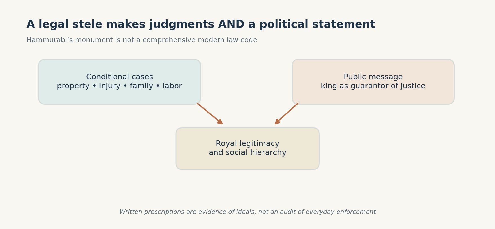

В началото на второто хилядолетие BCE видя конкурентни династии и променящ се политически пейзаж. Вавилонският град станал известен, особено под управлението на Хамураби, който царувал през осемнадесети век пр.Хр. Един от най-известните паметници на древния Близък Изток е високата вписана стела, свързана с него, сега в Лувъра. Тя представя сборник от правни решения и принципи, основани на кралски претенции към правосъдието и божествената власт. \[<a href="/011-mesopotamia-and-the-first-states/sources/#source-16" class="cite">16</a>\]\[<a href="/011-mesopotamia-and-the-first-states/sources/#source-17" class="cite">17</a>\]

Наричайки го "Кодексът на Хамураби" е традиционен, но може да създаде заблуждаващо съвременно впечатление. Лувърът обяснява, че това не е цялостен правен кодекс в съвременния смисъл на думата; неговите разпоредби за оцеляване представляват конкретни случаи, свързани с имущество, търговия, семейство, труд, насилие, отговорност и статут. Има и политическо послание: царят се поставя като такъв, който защитава справедливостта. \[<a href="/011-mesopotamia-and-the-first-states/sources/#source-16" class="cite">16</a>\]

Разпоредбите разкриват остри социални различия. Различните хора могат да получат различно правно лечение в зависимост от статута, секса, отношенията с имота и конкретното престъпление. Някои присъди изглеждат сурови към съвременните читатели. Други илюстрират познатите днес проблеми, отговорността за вредите и необходимостта от разрешаване на спорове. Древна правна колекция е доказателство за идеали, класификации и твърдения, а не доказателство, че всяко правило е било изпълнено точно както е написано във всяко село.

Черната стела си има своя история. По-късно той бил пренесен в Суза, понастоящем Иран и преоткрит там в началото на ХХ век. Мястото му ни напомня, че обектите се движат през завоевание, събиране и археология; мястото на откритието не винаги е мястото на сътворението. Това е точният урок, който практикувахме в глава 4.

<figure class="figure" id="figure-11-8">

<figcaption>Фигура 11.8. Хамурабис Стейл съчетава условни случаи и публична идеология на законното кралско управление. <a class="figure-anchor" href="#figure-11-8" aria-label="Link to this figure">#</a></figcaption>
</figure>
