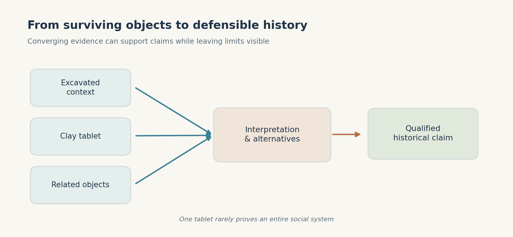

Представете си, че един екскаватор намери малка плоча в слой, свързан със сграда близо до Урук. Съдържа цифри и знаци за стоки. Едно изкушаващо заглавие гласи: "Древните данъчни документи доказват, че кралят контролира цялото земеделие." Какво всъщност ни казва плочата? Първо, изглежда, че записва количества и категории. Неговият слой предлага дата диапазон, предмет на смущения и методи за запознанства. Сценарият му може да се сравни с други таблети. Но съществуването на счетоводство не доказва, че всяко плащане е било данък, че кралят лично го контролира или че всички домакинства са били под един централен план.

Сега добави независими наблюдения. Тюлените се появяват в близост до складовете; няколко сгради показват признаци на организирана продукция; по-късно таблетите споменават официални лица. Започва да се формира картина на институционална администрация. И все пак трябва да разграничим периода на всеки източник, мястото, където е открит и обхвата на институцията, която представлява. Увереността трябва да се повиши с конвергиращи доказателства, а не със силата на разказа.

Силната Месопотамска история също разглежда проблема с опазването. Клей понякога оцелява чудесно; дърво, текстил и повечето ежедневни речи обикновено не. Огънят може случайно да пече таблетки и да запази временен офис рекорд в продължение на хилядолетия. Случайното оцеляване на един архив може да преувеличи важността на една институция спрямо другите, чиито записи са били изгубени. Не можем да предположим, че това, което оцелява е най-важното за хората, живеещи там.

Този метод е мостът от глава 4 до всички исторически глави напред. Ние не събираме легенди за велики цивилизации. Реконструираме обяснения от непълни следи. Ако можете да попитате как е установено археологическо твърдение, кои източници го подкрепят и какви алтернативни разкази остават правдоподобни, започвате да мислите като историк.

<figure class="figure" id="figure-11-9">

<figcaption>Фигура 11.9. Историческата интерпретация се основава на контекст, документи и предмети; един обект рядко доказва цяла политическа система. <a class="figure-anchor" href="#figure-11-9" aria-label="Link to this figure">#</a></figcaption>
</figure>
