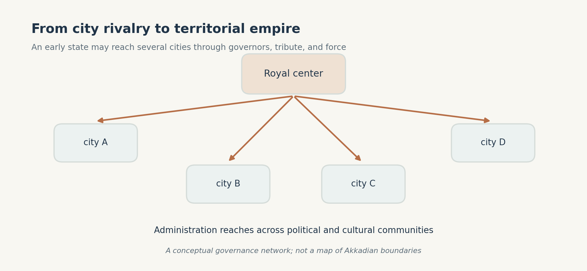

Около двадесет и четвърти век пр.н.е. политическият пейзаж се променя драматично. Саргон от Акад и владетелите, които го последвали, донесли много градове под по-широко териториално правителство чрез завоевание. Династията Акадски често е идентифицирана като една от най-ранните големи териториални империи, дори ако по-ранни държави са упражнявали широка регионална власт. Политическият център "Агаде" или "Акад" не е сигурно разположен. \[<a href="/011-mesopotamia-and-the-first-states/sources/#source-10" class="cite">10</a>\]\[<a href="/011-mesopotamia-and-the-first-states/sources/#source-13" class="cite">13</a>\]

Империята е различна от колекция от съюзнически градове-държави. Покоряващият владетел може да изисква почит, да назначава представители, да налага задължения и да се опитва да регулира териториите, обитавани от хора с различни местни идентичности. Тези договорености могат да разширят комуникацията и търговията, но също така увеличават разходите, създават устойчивост и изискват повече администрация. Само завоеванието не може да гарантира стабилност. Войниците се нуждаят от разпоредби; губернаторите могат да действат независимо; местните елити могат да си сътрудничат или да се бунтуват; далечните общности може да имат централна власт както като възможност, така и като потисничество.

По-късно традициите приписват на Саргон драматично издигане на властта. Кралете често били празнувани чрез истории, които укрепвали тяхната легитимност. Историците сравняват тези историци с надписи, административни доказателства и археология. Военното постижение на династията е значително, но легендите за основателя й не трябва да се повтарят като немедиирани биографии. Можем да знаем, че една империя се е появила без да знае всеки детайл от детството или мотивите на владетеля.

Акадският, семитски език, станал важен в императорския и административния контекст; шумерските културни и племенни традиции не просто изчезнали. Взаимодействието на езици и институции е една от основните черти на империята. Завоевателите управляват чрез съществуващи местни мрежи дори когато променят баланса на властта. Акадският период е свързан и с забележително кралско изкуство, включително образи, които издигат царството. Историята му ни напомня, че голяма област може да бъде административно сложна и политически уязвима едновременно.

<figure class="figure" id="figure-11-7">

<figcaption>Фигура 11.7. Администрацията на териториална империя изисква взаимоотношения между царската власт и многобройните местни центрове. <a class="figure-anchor" href="#figure-11-7" aria-label="Link to this figure">#</a></figcaption>
</figure>
