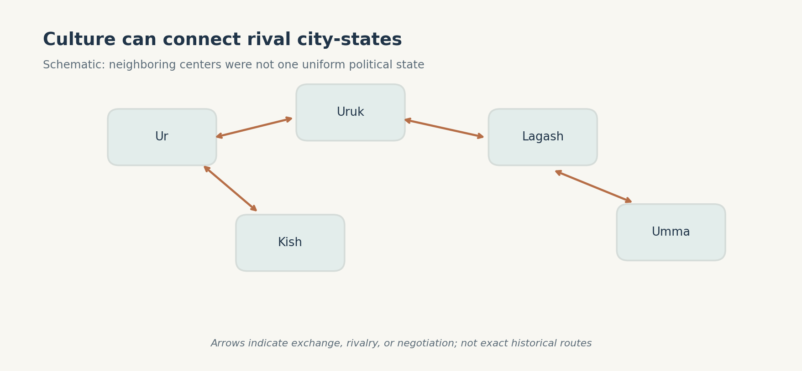

В периода на ранните династии, около 2900 и 2350 BCE, южна Месопотамия съдържа съперничещи градове-държави. Урук, Ур, Лагаш, Умма, Киш и други центрове не са отдели на една модерна страна, наречена Шумер. Те имали свои собствени политически истории, променящи се съюзи, владетели и териториални интереси. Шумерският език и свързаните с него културни традиции не създават непременно една политическа общност. \[<a href="/011-mesopotamia-and-the-first-states/sources/#source-4" class="cite">4</a>\]\[<a href="/011-mesopotamia-and-the-first-states/sources/#source-10" class="cite">10</a>\]

Тази разлика трябва да звучи познато от предишния ни урок за нациите и държавите. Споделената културна или езикова среда не гарантира единно правителство. Ривалните градове могат да почетат припокриването на религиозните традиции, размяната на стоки, приемането на подобни практики и все още се борят за земя и предимство. Някои селища доминирали временно съседите си. Други загубиха влияние. Властта може да бъде местна, регионална или достатъчно амбициозна, за да достигне далеч отвъд един град.

Терминът "градско-държава" е полезен, но несъвършен: древният териториален контрол може да е бил договорен, оспорван и преместващ се. Не е имало единна национална граница, очертана през модерен политически атлас. Властта на един град може да зависи от канали, ниви, приточни селища, съюзи и военния капацитет на неговите владетели. Твърдение върху надпис ни показва как един орган е искал да бъде разбран спорен пейзаж; то не доказва непременно, че всеки е приел твърдението.

Докато се биеха градовете-държавите, те също се учеха един от друг. Ривалството можело да мотивира паметници, отбранителна работа, нови титли и твърдения за божествена подкрепа. Войната може да премести пленници и стоки. Победата може да издигне владетел; поражението може да разкрие администрацията. Най-полезният въпрос не е "Кой град беше пръв?," а "Как конкуренцията промени институциите, които организираха ежедневието?"

<figure class="figure" id="figure-11-6">

<figcaption>Фигура 11.6. Шумер-говорещите градове-държави могат да споделят културни практики, като същевременно запазват независима политическа власт. <a class="figure-anchor" href="#figure-11-6" aria-label="Link to this figure">#</a></figcaption>
</figure>
