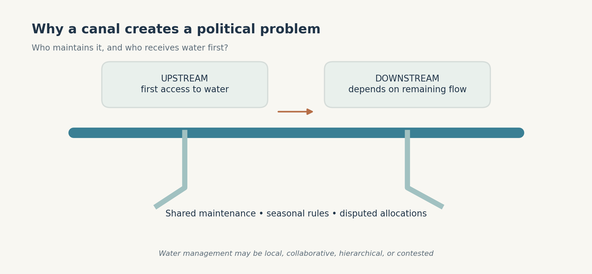

Представете си две земеделски общности, които споделят канал. Обществото нагоре по течението може първо да вземе вода. Обществото надолу по веригата се страхува, че прекомерното разсейване ще остави реколтата си суха. И двете се нуждаят от прочистване на канала след натрупване на тиня, но нито пък искат да доставят по-голямата част от работата, ако другата ще се възползват еднакво. Сушата вдига залозите; реколтата от бронята може да намали незабавното налягане. Това са повтарящи се проблеми, свързани с координацията, които биха могли да насърчат договорените правила, обществената работа, административния надзор или при някои обстоятелства - корективната власт.

Този пример е модел, а не запис от разкопан съд на канала. В него се обяснява защо селскостопанският ландшафт генерира изисквания към институциите. Каналът е инфраструктура: изисква строителство, поддръжка, тайминг и понякога санкции срещу хора, които нарушават споразумение. Също така създава зависимост. Същият канал, който увеличава добива, може да постави земеделските стопани в конфликт, ако ползата от едно домакинство намалява водоснабдяването на друго.

По-старата стипендия понякога третирала напояването като единствена причина за централизираните състояния: големите напоителни работи, уж изисквали деспотични владетели. Това е твърде метене. Някои системи за напояване са организирани на местно ниво; някои държави зависят повече от войни, идеология, обмен или почит; а водните пътища могат да се управляват без нито един владетел. Археолозите тестват отношенията между каналите, моделите на уреждане и политическите институции, вместо да приемат, че една технологична нужда определя цяла политическа система.

Една полезна системна схема би показала два пътя. Управлението на водите може да повиши надеждността на реколтата, да насърчи уреждането и инвестициите; в същото време концентрираният контрол върху портите, труда и записите може да създаде неравнопоставена сила за договаряне. Водата може да подпомогне сътрудничеството и конфликта. Институционалният въпрос не е само колко зърно се произвежда, но и кой решава кой да получи водата, кой трябва да поддържа канала и кой ще понесе цената, когато се провали.

<figure class="figure" id="figure-11-3">

<figcaption>Фигура 11.3. Две земеделски общности споделят ползите и рисковете от един напоителен канал. Правата на водата изискват координация. <a class="figure-anchor" href="#figure-11-3" aria-label="Link to this figure">#</a></figcaption>
</figure>
