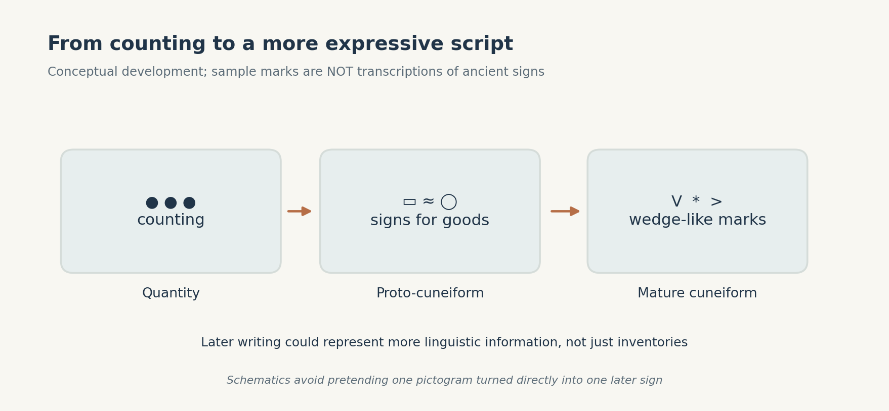

Сред най-следствените находки от края на четвъртото хилядолетие са таблетки, съдържащи цифри и знаци за стоки и административни категории. Най-ранните етапи на този скрипт обикновено се описват като прото-кюниформа. Техните марки все още не функционират по същия начин, както напълно развитото писане, способно да изрази всяко изказано твърдение. С течение на времето знаците стават все по-абстрактни и системата е адаптирана, за да представлява звуците и структурите на говорените езици. Това развитие не се случи за една нощ. \[<a href="/011-mesopotamia-and-the-first-states/sources/#source-1" class="cite">1</a>\]\[<a href="/011-mesopotamia-and-the-first-states/sources/#source-2" class="cite">2</a>\]

Ранните таблетки могат да идентифицират количествата зърно или други стоки. Разказват ни за мениджмънта и счетоводството, преди да ни кажат много за личните емоции. Някои знаци първоначално представлявали обекти или понятия; по-късните знаци можели също да представляват звуци, даващи възможност за имена, граматически форми и литературно изразяване. В зряла клинописна, клиновидни белези са били натиснати със стилус в глина. Една и съща технология за писане в крайна сметка записва повече от един език, особено шумерските и акадските, които принадлежат към различни езикови семейства. \[<a href="/011-mesopotamia-and-the-first-states/sources/#source-2" class="cite">2</a>\]\[<a href="/011-mesopotamia-and-the-first-states/sources/#source-7" class="cite">7</a>\]

Изкушаващо е да се каже, че шумерците "измисляли писане" и спрели. Необходими са две корекции. Първо, археологическата последователност остава непълна и учените обсъждат отношенията между различните системи за отчитане и маркиране. Второ, египетската система за писане се появи около същия широк период от време и процесите на влияние и независимо развитие остават въпрос на стипендия. Смисленото постижение е изобретяването и изработването на трайни средства за представяне на информация по начини, които могат да пътуват отвъд директната човешка памет.

Не си представяй, че грамотността изведнъж се разпространява на всички. В ранните етапи писането беше специализирано и обучението изискваше време. За много хора градът все още е бил опитен преди всичко чрез реч, ритуал, труд, стоки и лични взаимоотношения. Но една малка грамотна класа можела да запази транзакции, учения, политически прокламации и молитви по начини, недостъпни за предишните поколения. По - големият парадокс е, че записите, написани за администрирането на днешното зърно, се превърнаха в доказателство, с което изучаваме едно общество хиляди години по - късно.

<figure class="figure" id="figure-11-5">

<figcaption>Фигура 11.5. Концептуално развитие от количества и стокови знаци към скрипт, способен да записва език. <a class="figure-anchor" href="#figure-11-5" aria-label="Link to this figure">#</a></figcaption>
</figure>
