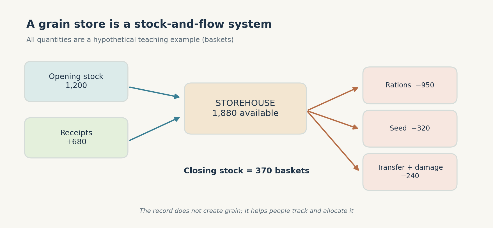

Да разгледаме един пример, основан на видовете счетоводни предизвикателства, които се появяват в ранните административни текстове. Склад започва сезона с 1200 кошници зърно. Получава още 680. Институцията разпределя 950 като дажби, отделя 320 за семена, прехвърля 180 към друго споразумение и губи 60 за щети. Крайната наличност е 1200 + 680 - 950 - 320 - 180 - 60 = 370 кошници. Тук не се превежда древна плоча от Урук; тези числа са модерни и хипотетични.

Математиката е проста. Социалните последствия не са. Да предположим, че чиновник запише прехвърлянето, но не и повреденото зърно. Администратора смята, че 430 кошници остават, а не 370 и обещава дажби, които складът не може да предостави. Липсващото досие може да създаде очевиден недостиг. Фалшивото досие може да прикрие разсейването. Последователна мерна единица и признат човек или тюлен, отговорен за доставката, стават ценни, защото споразумение, което обхваща много хора, трябва да бъде проверимо.

По-късно се развили мезопотамски системи, сложни метрология и счетоводство с различни конвенции за измерване на стоки и сделки. Не допускайте, че един модерен килограм или една модерна кошница се равнява на древна стандартизирана единица. Вместо това запомнете концептуалния скок: хората организираха потоци от ресурси през времето. Разграничаването на 7 глава между запасите и потоците изведнъж се вижда в древния свят: прибирането на реколтата увеличава запаса, дажбите и трансферите го понижават, а рекордът позволява на институциите да сравнят очакванията с реалността.

Не бива да превръщаме това в романтично твърдение, че счетоводството е създало цивилизация. Хората управляваха задължения без писане в продължение на хиляди години, а икономическите записи не могат да разкрият всяка форма на социално доверие или обмен. Но трайната администрация позволила на някои институции да станат по-големи, по-сложни и по-устойчиви. Скромното влизане за зърното е част от същия исторически разговор като храма, владетеля или стените на града.

<figure class="figure" id="figure-11-4">

<figcaption>Фигура 11.4. Работен хипотетичен счетоводен пример: заключителната акция се променя от разписки и изходящи потоци. <a class="figure-anchor" href="#figure-11-4" aria-label="Link to this figure">#</a></figcaption>
</figure>
