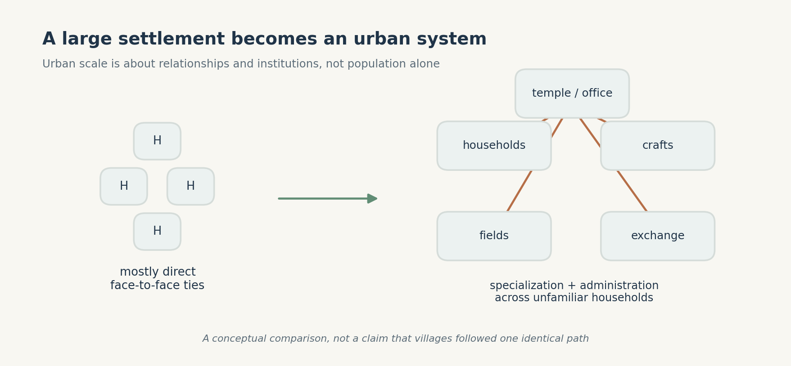

Около 3200 г. пр.н.е., Урук е извънредно селище в южна Месопотамия. Нейната монументална архитектура, обширна построена среда, специализирана продукция и административен материал я определят като ранен голям град. Сметките за точното му население се различават, защото археологията не може да брои всеки жител; самоуверените оценки на един брой трябва да се разглеждат като приблизителни стойности, а не като резултати от древно преброяване. Митрополитският музей го описва като сред най-големите селища в света за периода. \[<a href="/011-mesopotamia-and-the-first-states/sources/#source-1" class="cite">1</a>\]\[<a href="/011-mesopotamia-and-the-first-states/sources/#source-5" class="cite">5</a>\]

Това, което прави Урук ценен цяла глава в историята на градовете, не е само нейния размер. Селището съдържаше впечатляващи обществени и ритуални сгради, мащабна стенна декорация, производствени и складови практики и доказателства за организирано разпределение на ресурсите. Клей конуси, поставени в мазилка може да формира модели по видни стени. Масовите произведени съдове и административните печати свидетелстват за стандартизирани практики. Повечето посетители на древния Урук вероятно не се възхищавали на теорията за цивилизацията; те направлявали ежедневните нужди на място, където съществували големи институции и непознати хора един до друг.

Голямото население променя геометрията на социалния живот. В едно село от няколко десетки души много обмени могат да бъдат разбрани чрез пряко познанство, родство, репутация и преговори лице в лице. В един град може да получите храна от дистрибуторска система, да си купите инструмент от занаятчия, който не познавате, да се подчинявате на портиер, да работите по строителен проект и да участвате в спор с някой, чието семейство е непознато. Градът зависи от правила, очаквания и записи, които достигат отвъд малка общност.

Но броят на населението сам по себе си не обяснява всичко. Археолозите също така изучават институционалната плътност: концентрацията на дейности като администрация, религиозна практика, занаятчийска специализация и координация на труда. Развитието на Урук и взаимодействието му с други селища следователно са от значение повече от конкуренция за "първия град" в света, който не може да бъде решен точно. Съществуваха и други ранни градски центрове и комплексни селища, а определенията за един град се различават. \[<a href="/011-mesopotamia-and-the-first-states/sources/#source-5" class="cite">5</a>\]

<figure class="figure" id="figure-11-2">

<figcaption>Фигура 11.2. Градът включва специализирани дейности и институции, свързващи домакинствата извън непосредствените взаимоотношения лице в лице. <a class="figure-anchor" href="#figure-11-2" aria-label="Link to this figure">#</a></figcaption>
</figure>
