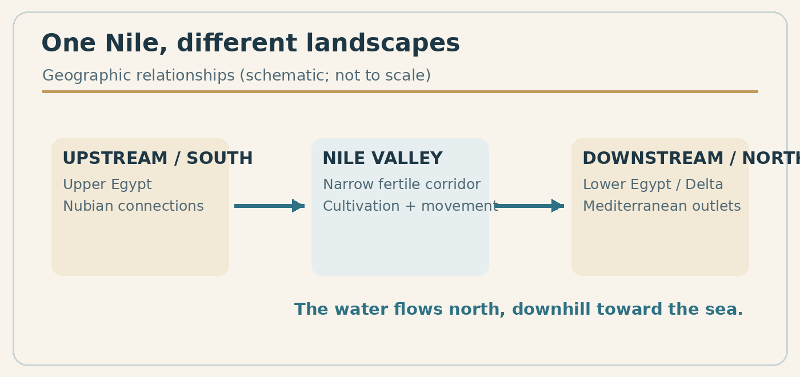

Нил се движи на север от водосборните води към Средиземно море. Тази проста ориентация смущава много учащи се, защото картите често поставят север в горната част и ни насърчават да си представим движение от горе до долу. Древните египтяни наричали южната долина Горен Египет и северната делта Долна Египет. Имената се отнасят до географията на реката нагоре и надолу по течението, а не до политическия ранг. Около средиземноморската делта реката се разделя на дистрибутори в широк алувиален пейзаж; по-на юг голяма част от култивираната зона заема сравнително тясна панделка до водата. \[<a href="/012-ancient-egypt-and-the-nile/sources/#source-3" class="cite">3</a>\]

Долината е граничила с пустини, но "пустиня" не означава празна стена. Пътищата през Източната пустиня свързвали Нил с Червено море и минерални райони. Западните оазиси свързват селищата с алтернативни пътища и оскъдни водни източници. На юг катарактата се простира на скалиста или небрежна река, но не отрязва Египет от Нубия. Следователно Нил е едновременно транспортен коридор и една линия в много по-голяма мрежа от възможности за опазване на околната среда и политически отношения.

Ежегодното наводнение било продукт на валежи по-нагоре, особено сезонните дъждове, които хранели Синия Нил и Атбара в североизточната част на Африка. Наводнената вода понесла утайка и помогнала за поддържането на земеделска земя в Египет, където дъждовете били оскъдни през голяма част от долината. Но потопът не бил гарантиран дар с предсказуем размер. Едно много ниско наводнение може да навреди на производството; разрушителен висок потоп би могъл да отмие собствеността и да усложни самоусъвършенстването. Водата изисквала и местни решения: кои полета били получени, когато басейните били отворени или източени, които поддържали дигите и как се съхранявало зърното. Селскостопански пейзаж не е просто намерен; той се управлява. \[<a href="/012-ancient-egypt-and-the-nile/sources/#source-3" class="cite">3</a>\]\[<a href="/012-ancient-egypt-and-the-nile/sources/#source-4" class="cite">4</a>\]

<figure class="figure" id="figure-12-1">

<figcaption>Фигура 12.1. Реката свързва нагоре по Горен Египет с надолу по течението Долен Египет и Делта; маршрутите и околната среда са схематични. <a class="figure-anchor" href="#figure-12-1" aria-label="Link to this figure">#</a></figcaption>
</figure>

Полезният умствен модел е свързана система. Климатът се отразява на поведението на потопа. Поведението на потопа оформя влагата в почвата и се предлага самоусъвършенстване. Земеделската продукция влияе върху хранителните магазини, данъчното облагане и политическата стабилност. Тези институции от своя страна могат да изградят инфраструктура, да натрупват резерви или да изискват повече от провинцията. Същото наводнение може да бъде тълкувано от свещеник като знак в космическия ред, от фермера като практически проблем и от служител като основа за оценка на постъпленията от зърно. Никоя от тези перспективи не отменя другите; всеки отговаря на различен въпрос.
