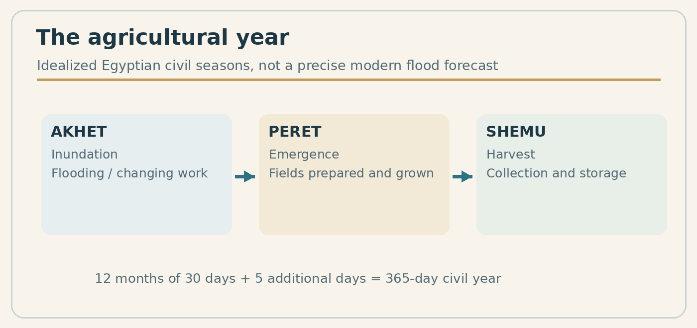

Класическият египетски граждански календар раздели годината на три четири месечни сезона, с пет допълнителни дни: Ахет, наводняването; Перет, появата или нарастващия сезон; и Шему, реколтата. Неговата 365-дневна структура е удобна за администриране, въпреки че без скок-ден корекция датите му се отнесоха бавно спрямо слънчевата година. Египтяните също наблюдавали астрономически явления, включително хелиакалното издигане на Сириус, но календарът не бил просто перфектен часовник за наводнение. Реката и човешкият календар са свързани без да бъдат механично идентични. \[<a href="/012-ancient-egypt-and-the-nile/sources/#source-5" class="cite">5</a>\]

Представете си измислено фермерско семейство в село край реката. Когато водата залязва в нивите, възможностите за труд и домакинските задачи се променят; когато тя отстъпи, земята трябва да се приготви и посее; по-късно реколтата трябва да бъде обработена и съхранена. Тази скица е по-скоро представителна, отколкото дневник от идентифицирано домакинство. Действителната работа варирала в продължение на векове, региони, типове области и социални позиции. Някои хора отглеждали зърно; други поддържали канали, превозвали стоки, работили в храмове, грижели се за животни, рисували текстил или правили инструменти. Данъчните изисквания на държавата са част от икономиката, в която домакинските договорености, местните задължения и институционалните имоти също имат значение.

Ето опростено изчисление, за да се разкрие институционалният проблем. Да предположим, че хипотетичното споразумение очаква 1000 чувала зърно. След ниско наводнение, тя жъне 720. Тя се нуждае от 400 за домашна храна, 120 за семена и 100 за местни задължения; това оставя само 100 чувала като буфер преди загуби или допълнителни искания. Ако длъжностно лице настоява за данъчна оценка въз основа на първоначалната очаквана реколта, очевидният излишък изчезва. Това е образователен сценарий, а не древноегипетски разказ. То показва защо измерването на селскостопанското производство, защитата на зърното от семена и реагирането на недостига са икономически и политически въпроси.

<figure class="figure" id="figure-12-2">

<figcaption>Фигура 12.2. Трите граждански сезона организираха време около потопа, растежа и жътвата; историческият период варираше. <a class="figure-anchor" href="#figure-12-2" aria-label="Link to this figure">#</a></figcaption>
</figure>

Изкушаващо е да си представим план за управление на всеки канал от кралския дворец. Археологическите и исторически доказателства подкрепят значителна организация на водата и земеделието, но точният мащаб на централния хидравличен контрол се променя с течение на времето и местоположението. Всички селища, имоти, местни служители и управници могат да участват. Способността да се координира една речна долина помага да се обясни държавната сила; това не доказва, че управлението на реката автоматично е създало всемогъщо състояние.
