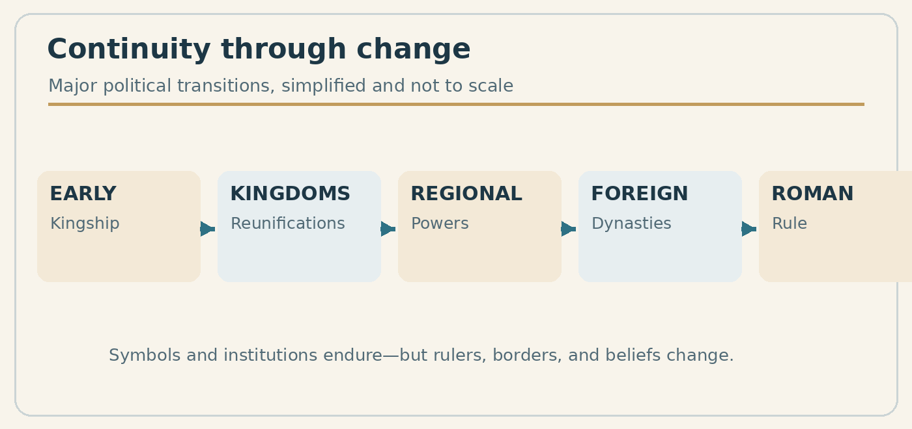

Политическата власт станала по - децентрализирана след Новото Царство. Различни династични групи и регионални правомощия упражняват влияние през третия междинен период. Египет остава културен продуктивни, икономически активни и исторически свързани дори когато един кралски двор не доминира цялата долина. Това е важна корекция на историите, в които историческото значение свършва всеки път, когато един силен фараон изчезне. \[<a href="/012-ancient-egypt-and-the-nile/sources/#source-18" class="cite">18</a>\]

През първото хилядолетие пр.н.е. владетелите на Кушит построили царство, чиито водачи дошли да управляват Египет, като създали двадесет и пета династия. По - късно Египет се сблъскал с асирийската власт, изпитал нови местни династии и периоди на персийско управление. Тези събития не са идентични епизоди на чуждо завоевание; всеки от тях включва различни политически договорености и степени на културно взаимодействие. Местните египетски институции и религиозни практики продължавали и се адаптирали при множество управляващи къщи. \[<a href="/012-ancient-egypt-and-the-nile/sources/#source-18" class="cite">18</a>\]\[<a href="/012-ancient-egypt-and-the-nile/sources/#source-22" class="cite">22</a>\]

Александър Македон влязъл в Египет през 332 г. пр.н.е., а след смъртта си Птолемейската династия управлявала елинистично царство, съсредоточено върху Египет. Последният му владетел, Клеопатра VII, оперирал в римска дипломатическа среда. Когато римските сили победили съюза й с Марк Антоний, Египет бил под римско управление през 30 г. пр.н.е. Тази дата бележи голям политически преход, а не моментното изчезване на египетските езици, хора или свещени традиции. \[<a href="/012-ancient-egypt-and-the-nile/sources/#source-22" class="cite">22</a>\]

<figure class="figure" id="figure-12-11">

<figcaption>Фигура 12.11. Политическата история показва повтаряща се разпокъсаност, нови управляващи къщи и институционални постоянство. <a class="figure-anchor" href="#figure-12-11" aria-label="Link to this figure">#</a></figcaption>
</figure>

Фразата "древен Египет продължи три хиляди години" е полезна като чувство за мащаб, но потенциално подвеждаща. Историците не описват една непроменяща се политическа институция, идентични национални граници или едно непрекъснато население да се държи като такава. През този период имаше повтарящи се реконструкции на власт, демографски промени, чуждестранни контакти, религиозно развитие и езикови преходи. Самата продължителност е създадена и тълкувана от хора, които са достигнали назад до предишни прецеденти.
