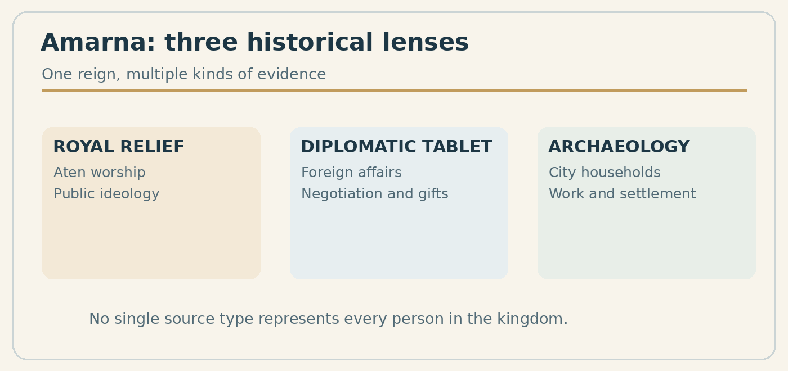

Друг владетел на династия 18, Аменхотеп IV... по-късно Ехнатон... насърчил един необичайно концентриран кралски култ, фокусиран върху "Атен," слънчевият диск. Той създаде нов кралски резиденция и церемониален център в Ахетен, модерна Амарна, и прие отличителни художествени и религиозни практики. Драматичните различия в оцелелите образи са направили управлението му известно, но някои по - стари разкази преувеличават как напълно страната изоставила предишния религиозен живот или колко равномерно бил приеман новият култ. \[<a href="/012-ancient-egypt-and-the-nile/sources/#source-16" class="cite">16</a>\]

Реформата беше трансформация на елитната религиозна политика, монументална практика и публичния имидж на съда. Дали това означавало монотеизъм в точния смисъл, използван за много по-късни религиозни традиции? Учените не са съгласни относно терминологията и как да интерпретират представянията на другите богове от периода. Атенизмът често е по-безопасен етикет, отколкото твърдението, че една модерна категория отговаря напълно на доказателствата. Това, което може да бъде установено по-уверено, е необикновеният кралски фокус върху "Атън" и промените, наложени върху публичното поклонение и образи. \[<a href="/012-ancient-egypt-and-the-nile/sources/#source-16" class="cite">16</a>\]

<figure class="figure" id="figure-12-8">

<figcaption>Фигура 12.8. Кралски изображения, дипломатически таблети и градска археология отговарят на различни въпроси за периода Амарна. <a class="figure-anchor" href="#figure-12-8" aria-label="Link to this figure">#</a></figcaption>
</figure>

Буквите от Амарна предлагат паралелна перспектива. Те не са богословски манифести; мнозина се отнасят до практическите проблеми на комуникацията и геополитическите отношения. Тяхното съществуване ни пречи да се преструваме, че религиозната реформа е заменила бизнеса на правителството. След Ехнатон съдът се оттеглил от експеримента в Амарна и възстановил много преди това установени култове. Тутанкамон е познато име отчасти заради изключителното съхранение на гробницата му, а не защото неговото управление е задължително по-политически влиятелно от това на много по-малко известни владетели.

Една добре запазена гробница може да изкриви историческата памет. Крал, чието погребение е избягало от голям грабеж, може да стане световно известен, докато институция, която организира живота на хиляди хора, оставя по-малко зрелищни предмети. Историческото значение и археологическата видимост са различни променливи. Отличието е централно за целия проект Knowledge Kingdom.
