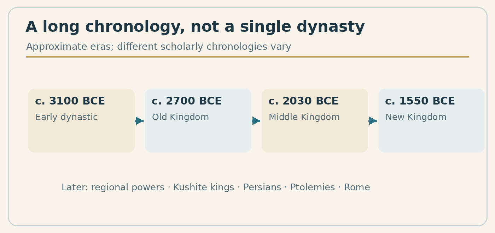

Известен предмет на плочите - "Нермер палет," изобразява владетел, носещ корони, свързани с Горен и Долен Египет в сцени на господство и ред. Това е доказателство, че ранната царска власт била визуално представена чрез езика на победата и двете страни. Това не е камера запис на нито една решителна битка в известен следобед. Историците спорят как да свържат обекта с процеса на политическо обединение, церемониалната му обстановка и самоличностите, запазени в по-късните списъци на царете. \[<a href="/012-ancient-egypt-and-the-nile/sources/#source-6" class="cite">6</a>\]\[<a href="/012-ancient-egypt-and-the-nile/sources/#source-7" class="cite">7</a>\]

По - късно традицията ознаменува един ранен обединяващ цар на име Менес. Съвременните исторически реконструкции често обсъждат Нармер и Аха във връзка с тази традиция, но отношенията между имена, заглавия и по-късни акаунти не са напълно уредени. Познатата дата около 3100 BCE е полезна ориентация, а не ден отпечатана върху модерен акт за раждане. Египетската хронология се събира чрез археологически слоеве, съвременни надписи, царски списъци, астрономически доказателства и сравнения с други региони. Различните стандартни хронология може да се различават с десетилетия, особено в по-ранни периоди. \[<a href="/012-ancient-egypt-and-the-nile/sources/#source-7" class="cite">7</a>\]

<figure class="figure" id="figure-12-3">

<figcaption>Фигура 12.3. Приблизителни ранни фази на египетската история; това са хронологични пътеводители, а не точни граници. <a class="figure-anchor" href="#figure-12-3" aria-label="Link to this figure">#</a></figcaption>
</figure>

Двойната корона е мощен символ: суверенитет над север и юг, представен като идеално цяло. Но изображенията на единството също са част от процеса, чрез който се твърди, че е единство. Един по - късно цар може да подчертае продължаващата традиция именно защото елитите, провинциите, градовете и регионалните интереси трябва да бъдат обединени. Историците трябва да попитат кой орган е поръчал образ, къде се е появил и какви алтернативни перспективи липсват.
