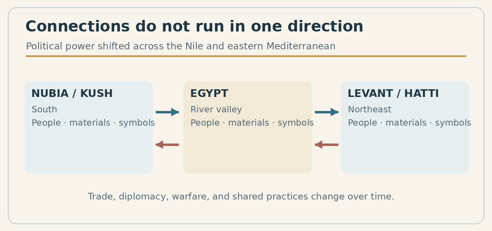

Нил свързва Египет с районите, които обикновено се наричат Нубия, включително териториите на днешния южен Египет и Северен Судан, но отношенията никога не са били проста история за Египет "цивилизиране" друг празен юг. Нубийските общности развиват различни политически традиции, опит, търговски мрежи и кралски култури. Царството, центрирано върху Керма, беше огромна регионална сила много преди по-късните Напатански и Мероитски фази, свързани с Куш. Египетските владетели в различни времена търгували с, завладявали, воювали и се учели от нубийските общества. \[<a href="/012-ancient-egypt-and-the-nile/sources/#source-11" class="cite">11</a>\]

Египетските надписи често използували познати категории чуждество и подчинение, особено когато царете искали да рекламират господството. Такива текстове са доказателство за египетска кралска идеология, а не неутрални етнографии на нубийския живот. Археология от Нубийските селища, гробища и паметници показва политическа и културна сложност отвъд това, което вражеските надписи записват. По време на Новото Царство Египет упражнявал обширен контрол над части от Нубия; по - късно балансът на властта се обърнал. Кралете от Куш управлявали Египет като двадесет и пета династия през първото хилядолетие преди Христа. \[<a href="/012-ancient-egypt-and-the-nile/sources/#source-11" class="cite">11</a>\]\[<a href="/012-ancient-egypt-and-the-nile/sources/#source-18" class="cite">18</a>\]

<figure class="figure" id="figure-12-9">

<figcaption>Фигура 12.9. Древен Египет участва в припокриването на африканските и западните азиатски мрежи за влияние и обмен. <a class="figure-anchor" href="#figure-12-9" aria-label="Link to this figure">#</a></figcaption>
</figure>

Това обръщане има интелектуално значение. То преобръща въображаемата перманентност на египетски център, който командва африканска периферия. Нубианските елити могат да приемат елементи от египетската иконография, да ги трансформират и да ги превърнат в част от собствената им политическа традиция. Културното заемане не означава непременно политическа зависимост, а споделените символи не изтриват отделни идентичности. Нил носел стоки, хора и религиозни форми в повече от една посока.

За световна историческа книга Египет принадлежи към африканската история, както и към средиземноморската и западна азиатската история. Това са допълнителни географски връзки, а не конкурентни етикети. Третирайки Египет само като европейски музеен спектакъл, той оставя настрана обществата и пейзажите, с които египтяните си взаимодействали през дългата си история.
