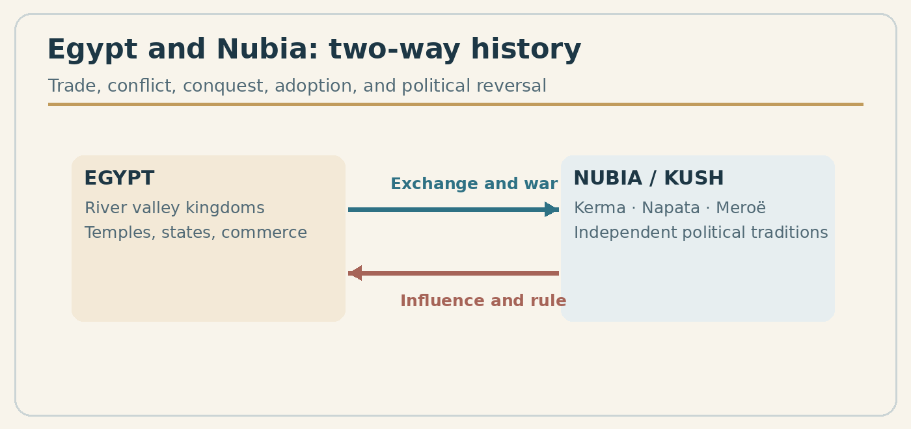

Обединението, свързано с Ментухотеп II, отбеляза началото на Средното кралство около 2030 г. пр.н.е. в една широко използвана хронология. По - късно владетелите, включително и тези на династия 12, инвестирали в административни структури, кралско строителство, литература, военна отбрана и търговия. Тива става основен религиозен и политически център; Мемфис и други места остават важни. Египет не бил просто "възстановен" към непроменен шаблон на старото Царство. Политическото въображение и художествените форми на Средното кралство имат свои отличителни черти. \[<a href="/012-ancient-egypt-and-the-nile/sources/#source-10" class="cite">10</a>\]

Литературата на Средното Царство включва творби, които поставят под въпрос лоялността, несигурността, елитното поведение и нестабилността на богатството. Не трябва автоматично да тълкуваме литературните герои като точните вярвания на техните автори или статистически представителен възглед за египетското общество. Но тези текстове затрудняват намаляването на периода до списък с крале. Кралските и частни паметници също разкриват различни начини за представяне на авторитета и благочестието.

Южните отношения с Нубия бяха централни. Египетските владетели създали крепости и контролирали или търсели контрол над маршрутите и територията близо до Втория Катаракт. През границата сложните нубийски общества развиват свои собствени институции, включително и важната полност, свързана с Керма. Египетските документи често представяли съседните народи чрез политически стереотипи; Нубийската археология коригирала илюзията, че регионът съществува само по отношение на Египет. \[<a href="/012-ancient-egypt-and-the-nile/sources/#source-11" class="cite">11</a>\]

<figure class="figure" id="figure-12-7">

<figcaption>Фигура 12.7. Египетските и нубийските истории включвали промяна на властта, обмяната, завладяването и културната адаптация. <a class="figure-anchor" href="#figure-12-7" aria-label="Link to this figure">#</a></figcaption>
</figure>

В крайна сметка Средното Царство отстъпило на друг сложен период на припокриване на властите. На север владетелите често наричали Хиксосите власт в части на Египет през Втория междинен период; южните управници поддържали конкурентни центрове. Хиксосите не трябва да се представят като цяла цивилизация, която е пристигнала една сутрин и е заменила всичко египетско. Възходът им включва хора и традиции, свързани със Западна Азия и Делтата, а интерпретацията се променя с нови археологически доказателства. След продължителен конфликт владетелите от Тива установиха нова фаза на национално обединение. \[<a href="/012-ancient-egypt-and-the-nile/sources/#source-12" class="cite">12</a>\]
