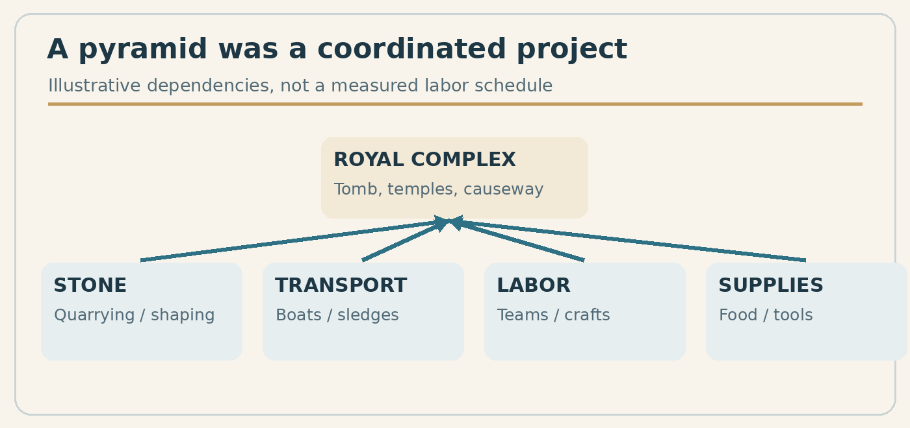

Старото кралство, обикновено датират от около третото хилядолетие пр.н.е. и често се свързва с династии 3бр.6, развива мощни форми на съдебна култура, монументална гробница сграда и провинциална администрация. Стъпковата пирамида на Джозер в Саккара е архитектурен експеримент с дълбоки последствия. По-късно четири династия крале, включително Snefru, Khufu, Khafre и Menkaure...развити пирамидални комплекси, чийто мащаб все още променя начина, по който посетителите си представят древния свят. В монументална последователност не е просто скок от една единствена идея за усъвършенстване на геометрията. Строителите експериментират с форми, материали, подравнявания и организация. \[<a href="/012-ancient-egypt-and-the-nile/sources/#source-2" class="cite">2</a>\]\[<a href="/012-ancient-egypt-and-the-nile/sources/#source-8" class="cite">8</a>\]

Една пирамида е била част от по-широк забавен пейзаж: храмове, пътеки, по-малки гробници, ритуални пространства, магазини и работни зони. Известната Велика пирамида е свързана с Куфу. Платото Гиза също така запазва доказателства за гробища, инфраструктура и трудови селища. Монументална сграда включва каменоломна, транспортирането й, осигуряването на храна и инструменти и координирането на специализирания труд. Прогнозите за работната сила и точните методи за преместване на големи блокове остават дискутирани; нито едно оцеляло доказателство не оправдава общото твърдение, че съвременните историци нямат представа как хората биха могли да построят пирамиди. Ние знаем важни механизми и ограничения, въпреки че подробности за конкретни рампи и строителни последователности остават теми на научните изследвания. \[<a href="/012-ancient-egypt-and-the-nile/sources/#source-1" class="cite">1</a>\]\[<a href="/012-ancient-egypt-and-the-nile/sources/#source-2" class="cite">2</a>\]\[<a href="/012-ancient-egypt-and-the-nile/sources/#source-8" class="cite">8</a>\]

<figure class="figure" id="figure-12-5">

<figcaption>Фигура 12.5. Основните паметници зависят от транспорта, труда, хранителните доставки и логистичната координация, както и от дизайна. <a class="figure-anchor" href="#figure-12-5" aria-label="Link to this figure">#</a></figcaption>
</figure>

Дали пирамидите били построени от поробени хора? Опростената картина на огромните анонимни робски банди, които вършат цялата работа, не се подкрепя от археологическата картина на организираните трудови общности, квалифицирани екипажи и държавно осигуряване. Но би било също толкова небрежно да се заключи, че всичкият труд е бил доброволен в съвременния смисъл. Древни задължения, korvée труд, зависимост, разлики в статута и епизоди на принуда са съществували в променящите се институции. Трябва да разграничим работната организация от законната свобода на работниците и да избегнем налагането на единен лейбъл за труда на всеки работник и век.

Каменният паметник ни учи за капацитета и вярванията. Тя не доказва, че всяко домакинство е процъфтявало. Ето защо останките от производството на хляб, грънчарство, хранителни кости и жилища са толкова ценни. Отдалечават камерата от краля. Обикновените хора не бяха просто анонимното "задно място" на архитектурно постижение; тяхната работа и решения бяха необходимите условия.
