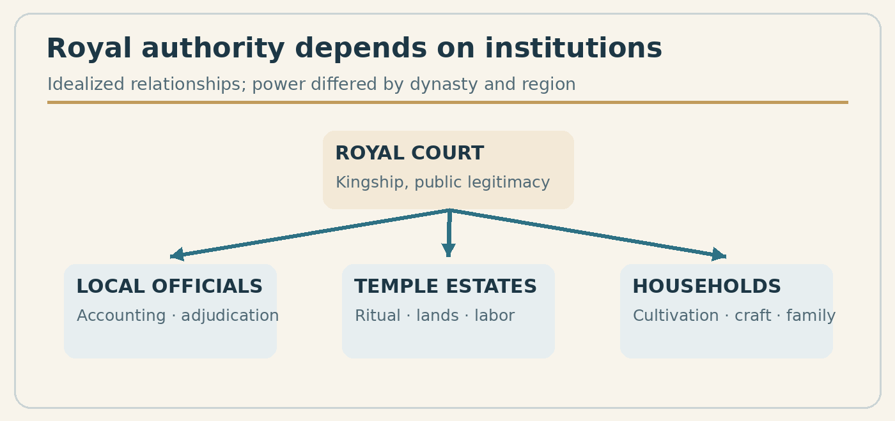

Фараонът бил централната фигура на египетското царство, но царската власт се управлявала чрез домакинства, служители, храмове, военни единици, имоти и местни общности. Заглавието, преведено като "пираох," нараснало от термина "велик дом" и по-късно в египетската история започнало да се използва редовно за суверена. Използването му за много ранни владетели е удобен съвременен конгрес, а не доказателство, че всички в първата династия са използвали думата по същия начин. \[<a href="/012-ancient-egypt-and-the-nile/sources/#source-7" class="cite">7</a>\]

Египетската кралска идеология направи краля отговорен за защитата на Мат: идеал за истина, справедливост, правилен ред и подходящ баланс. Концепцията беше религиозна и политическа; това не означаваше, че всяко решение на царя е справедливо. Кралските текстове често изобразяват покорни врагове, поддържани приноси, построени храмове и възстановена хармонична земя. Тези конвенции изразяват стремежи и претенции за легитимност. Администраторите били изправени пред обикновени ограничения: получаване на зърно, отчитане на труда, изпращане на инструкции по протежение на Нил, управление на длъжностни лица, решаване на спорове за земя и комуникация през разстоянията.

Обърни внимание на везира, висша административна фигура, чиито отговорности се променили през династиите. В надписи и служебни списъци висшите служители могат да се хвалят, че съдят справедливо, събират данъци, надзирават произведенията или служат на царя. Тези титли показват как авторитетът е бил представен и делегиран. Те не доказват, че населението е преживяло безпристрастна бюрокрация. Един владетел може да има нужда от служители именно защото владетелят не може лично да контролира всяко село. Длъжностните лица могат да разширят кралската власт и едновременно да станат могъщи актьори по свое собствено право.

<figure class="figure" id="figure-12-4">

<figcaption>Фигура 12.4. Кралската администрация работи чрез служители, храмове, домакинства и взаимоотношения, които се променят с течение на времето. <a class="figure-anchor" href="#figure-12-4" aria-label="Link to this figure">#</a></figcaption>
</figure>

Също така трябва да се противопоставим на поставянето на Египет в модерна политическа категория. Тя имаше принуда, офиси, подобни на закона практики и идеологически претенции, но нямаше нито една писмена конституция, наподобяваща съвременното конституционно правителство. Нито пък "божественото царуване" трябва да бъде третирано като вечна формула. Форми на кралска божественост, наследяване, връзки с храмове и обществен образ са еволюирали повече от две хилядолетия.
