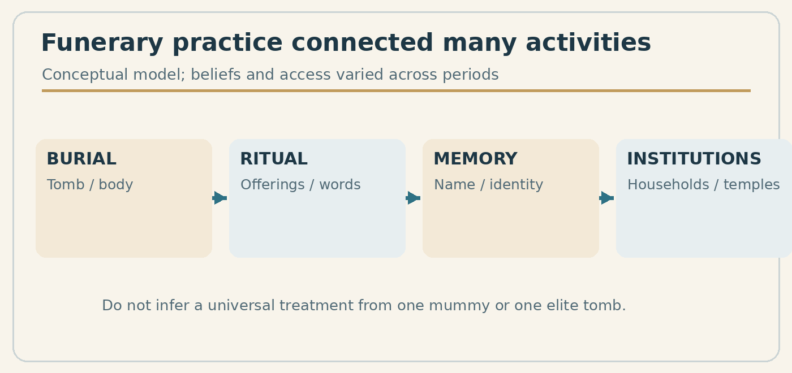

Гробниците не са били просто складове за трупове. Египетските погребални вярвания свързвали продължаващото съществуване на човека с опазването на тялото, подходящи ритуали, идентичност, памет и приноси. Идеите се промениха значително с течение на времето и между социалните групи. Ранните елитни погребения, пирамидалните комплекси на старото Царство, ковчезите на Средното Царство и по - късните погребални папири не били идентични изрази на определена религия. Някои практики стават достъпни за по - големи групи с течение на времето, докато богатството все още оформя това, което хората могат да си позволят. \[<a href="/012-ancient-egypt-and-the-nile/sources/#source-8" class="cite">8</a>\]\[<a href="/012-ancient-egypt-and-the-nile/sources/#source-9" class="cite">9</a>\]

Египетският човек беше разбран чрез няколко взаимно свързани измерения, които обикновено се превеждат в съвременните дискусии като ка, ба и акх, макар че превеждането им като три познати съвременни концепции може да заблуди. Ка може да се обсъжда по отношение на жизнената сила и препитанието; ба по отношение на мобилните или отличителните аспекти на дадено лице; и Акх във връзка с ефективно преобразено същество. Древните текстове са разнообразни и понякога трудно се съгласуват. Тяхната цел не е да преподават една модерна богословска система с идентични определения през периоди.

Мумифицирането се развива чрез много техники. Премахване и третиране на органи, натрон сушене, опаковане и ковчеже практики варира по период, място, средства и обстоятелства. Древните текстове не предоставят нито едно цялостно техническо ръководство. Затова археолозите се учат, като изследват оцелелите останки и ги сравняват внимателно, без да предполагат, че техниката, наблюдавана в една мумия описва всички египетски погребални практики. Пустините също така съхраняват телата естествено в някои контексти. \[<a href="/012-ancient-egypt-and-the-nile/sources/#source-9" class="cite">9</a>\]

<figure class="figure" id="figure-12-6">

<figcaption>Фигура 12.6. Забавни вярвания и институции са имали много свързани компоненти, с важни различия през периоди. <a class="figure-anchor" href="#figure-12-6" aria-label="Link to this figure">#</a></figcaption>
</figure>

Това, което прави това интелектуално важно, е взаимодействието между икономиката и идеологията. Гробница се нуждае от ресурси сега, за да поддържа надежда за идентичност след смъртта. Храмове и забавни дарове могат да притежават земя, да наемат специалисти и да създават текущи задължения. Вярата и материалните институции не били отделни вселени. Кралските паметници изразяват космология, докато организират труда и концентрират богатството. Историкът трябва да е в състояние да обясни всички тези функции, без да отхвърли вярата като просто извинение или третиране на административната власт като случайна.
