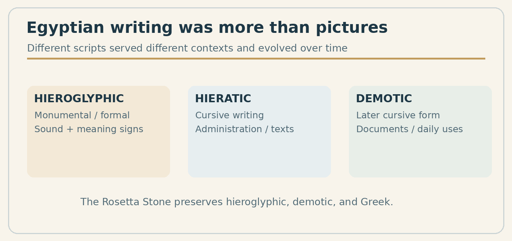

Египетските йероглифи били визуално поразителни знаци, използвани особено в монументални и формални контексти, но те били част от една по-широка традиция за писане, която също включвала курсивни форми като йератични и по-късно демотични. Писане на комбинирани знаци, които могат да представляват звуци с други знаци, които идентифицират значението или категориите думи. Това не беше просто език на картината, на която всяко изображение отговаряше на един очевиден обект. Много египетски надписи могат да бъдат четени днес, защото лингвистите и историците реконструирали езика и неговите скриптове чрез сравнителни доказателства. \[<a href="/012-ancient-egypt-and-the-nile/sources/#source-21" class="cite">21</a>\]

Известният Розета Стоун е указ от 196 г. пр.н.е., вписан в йероглифски сценарий, демотичен сценарий и гръцки. Нейните паралелни текстове решително допринесли за дешифрирането, заедно с работата на няколко учени и признаването, че йероглифите могат да представляват звуци. Камъкът не доставял внезапно всеки липсващ древен текст или се превеждал сам. Жан-Франсоа Шамполион направи решителен пробив в началото на деветнадесети век, основавайки се на по-ранни изследвания, включително и на Томас Йънг. \[<a href="/012-ancient-egypt-and-the-nile/sources/#source-21" class="cite">21</a>\]

<figure class="figure" id="figure-12-10">

<figcaption>Фигура 12.10. Египетското писане е използвало няколко сценария; всеки от тях се развива с течение на времето и нито един не е просто речник на картината. <a class="figure-anchor" href="#figure-12-10" aria-label="Link to this figure">#</a></figcaption>
</figure>

Административното писане съществувало в запасите, писмата и съдебните документи, но грамотността не била универсална. Писмената система може да овласти длъжностните лица и специалистите, както и да направи твърденията трайни. Наистина, един оцелял указ може да разкрие предпочитания от институцията образ на себе си, като прикрие критиките и всекидневните разногласия. Затова историкът чете писането като артефакт с продуцент, публика, цел и история на предаването.

Една изненадваща подробност е, че египетското писане продължило през огромни исторически промени. Коптски, по - късен етап от египетския език, написан главно в гръцки сценарий, оцелява като литургичен език. Древният египтянин не бил просто "изгубен" в един момент, когато последният фараон умрял. Езиците се трансформират, институциите се променят и скриптовете могат да надживеят държавите, които ги правят престижни.
