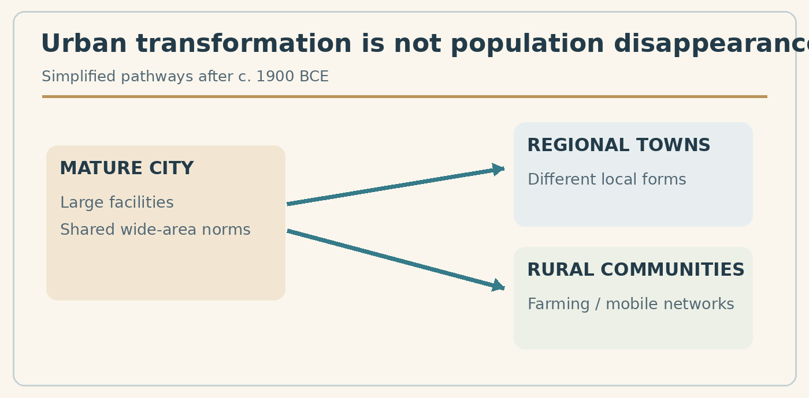

Около края на второто хилядолетие пр.н.е. широко разпространената градска система на възрастния Харапан се променила. На редица места големите градски центрове се споразумяха или вече не се поддържаха по същия начин. Размяна на дълги разстояния, някои стандартизирани форми на материали, плътност на селището и занаятчийски практики се промениха в различните региони. Много хора са живели в по-малки общности или са се преместили в различни области; общият модел често се описва като деурбанизация или регионализация, а не мигновено изчезване на населението. \[<a href="/013-the-indus-valley-civilization/sources/#source-6" class="cite">6</a>\]\[<a href="/013-the-indus-valley-civilization/sources/#source-8" class="cite">8</a>\]\[<a href="/013-the-indus-valley-civilization/sources/#source-20" class="cite">20</a>\]

Предлагат се няколко обяснения за взаимодействие: изменение на околната среда, намалена предвидимост на селското стопанство, промени в речните модели, променяща се търговия, трансформации в политическите и икономическите институции и други демографски или социални процеси. Доказателствата не оправдават нито една универсална причина, приложена към всеки сайт. Важното е, че по-възрастните хора твърдят, че нахлуващите армии са унищожили всички градове на Харапан, без убедителна археологическа подкрепа като общо обяснение за градския преход. Разпознаването на това не означава, че никъде не е имало конфликт. \[<a href="/013-the-indus-valley-civilization/sources/#source-6" class="cite">6</a>\]\[<a href="/013-the-indus-valley-civilization/sources/#source-20" class="cite">20</a>\]

<figure class="figure" id="figure-13-11">

<figcaption>Фигура 13.11. Деурбанизацията включва множество пътища на общностна приемственост и трансформация. <a class="figure-anchor" href="#figure-13-11" aria-label="Link to this figure">#</a></figcaption>
</figure>

Историята често се обърква, когато приравнява края на видимо състояние или градски стил със смъртта на култура. Падането на империя не означава, че нейните фермери са изчезнали; изоставянето на монументалното строителство не означава, че хората са забравили как да направят гърне, да пеят, да отглеждат семейства или да търгуват на местно ниво. В по-късните Харапан контексти археолозите намират постоянство, както и нови форми. Точните взаимоотношения между древните популации и по-късните общности трябва да бъдат разследвани в много региони и периоди, а не обявени чрез просто изречение за "потомците."

Помислете за глава 7 върху системите. Градският живот зависи от мрежа от потоци: храна, гориво, вода, специализирани стоки, доверие и труд. Една повреда в един поток може да направи друг поток по-скъп или по-малко надежден. Промените не трябва да бъдат драматични, за да имат значение повече от век. Случаят Инд предлага мощно въведение в историческата сложност: градският ред може постепенно да загуби условията, които поддържат мащаба му, докато човешките общности се адаптират и създават различни модели на живот.
