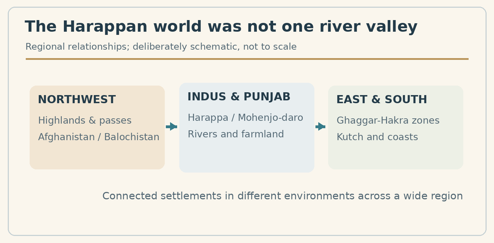

Цивилизацията "Индската долина" е полезно име, но географският й обхват е далеч отвъд една долина. Обекти, принадлежащи към по-широката традиция на Харапан, се появяват в голяма част от днешния Пакистан и северозападна Индия, като регионалните мрежи се простират към Афганистан, Арабското крайбрежие, западните Хималаи и границите на пустинята Тар. Страната на сърцето включва река Инд и нейните притоци, но места се срещат и в полу-аридни зони, по бивши канали и в крайбрежни среди. Наричайки го изключително речно общество, крие някои от най-интересните различия сред своите общности. \[<a href="/013-the-indus-valley-civilization/sources/#source-1" class="cite">1</a>\]\[<a href="/013-the-indus-valley-civilization/sources/#source-5" class="cite">5</a>\]

Самият Инд се издига във висока планинска среда и тече като цяло на югозапад през това, което сега е Пакистан към Арабско море. Нейната голяма приточна система свързва Пенджаб и съседните региони. Екологичната история на региона не е просто едно годишно копие на историята на Египет за Нил. Зимни смущения, летни мусонни валежи, планински сняг и лед, местни наводнения и сменящи се канали създават сложни регионални модели. Някои селища разчитали на близки реки, други на сезонни руноходове, кладенци, резервоари, местни земеделски системи или достъп до търговски маршрути. Различни части на Харапанския свят са имали различни рискове. \[<a href="/013-the-indus-valley-civilization/sources/#source-6" class="cite">6</a>\]\[<a href="/013-the-indus-valley-civilization/sources/#source-7" class="cite">7</a>\]

Основното географско правило има значение тук: днешната позиция на селището спрямо реката не е доказателство за древната позиция на реката. Водите се променят, седиментите се натрупват, човешката активност променя дренажа и някои древни канали вече са сухи. Изследователят трябва да комбинира разкопки, проучвания на седименти, датиране и възстановяване на околната среда, вместо да проследява модерна синя линия на картата назад четири хиляди години. Дебатът за каналите, често свързани със системата Гагар-Хакра, е пример за това защо разграничението на археологическите доказателства от географската митология е от съществено значение. \[<a href="/013-the-indus-valley-civilization/sources/#source-7" class="cite">7</a>\]

<figure class="figure" id="figure-13-1">

<figcaption>Фигура 13.1. Харапанският свят свързва много видове пейзажи; схемите не са буквална карта на сайта. <a class="figure-anchor" href="#figure-13-1" aria-label="Link to this figure">#</a></figcaption>
</figure>

Мисли за света на Инд като за взаимосвързана мозайка. Неговите северни и вътрешни центрове са имали достъп до определени земеделски нинтерланди; западните му региони са се намирали по маршрутите през иранското плато и Афганистан; южните крайбрежни селища могат да имат достъп до морски ресурси и морски обмен. Споделени форми на тухли, тюлени и тежести свързвали много места, но хората, които ги използвали, живеели в различни пейзажи. Географията ни помогна да направим сътрудничеството ценно, като запазим положението на всяка общност различно.
