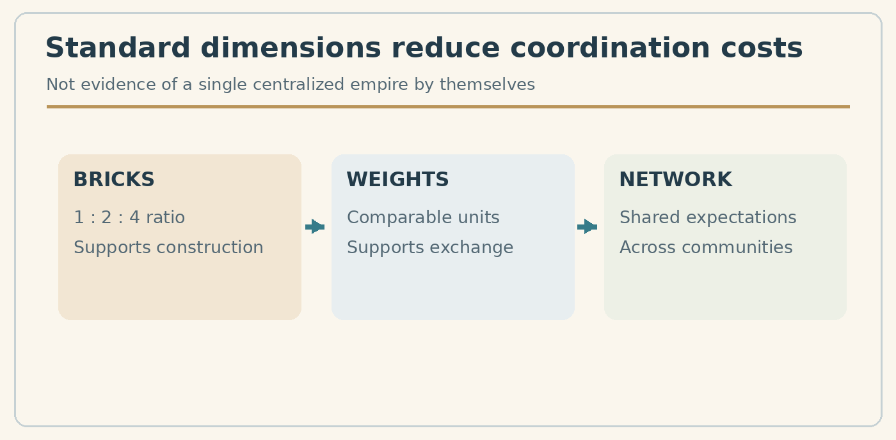

Един от най-силните материални признаци за интеграция на Харапан е честото използване на стандартизирани пропорции в тухли и тежести. Общата тухлена пропорция е 1:2:4 за дебелина, ширина и дължина, въпреки че действителните примери и практики варират във времето, функцията и мястото. Внимателно произведени кубични тежести, често направени от Черт, следват повтарящи се конвенции, които позволяват сравняване и проверка на сделките. Учените са изучавали своите системи и регионални дистрибуции, вместо просто да третират всяка подобна тухла като доказателство за реда на един бюрократ. \[<a href="/013-the-indus-valley-civilization/sources/#source-10" class="cite">10</a>\]\[<a href="/013-the-indus-valley-civilization/sources/#source-13" class="cite">13</a>\]

<figure class="figure" id="figure-13-5">

<figcaption>Фигура 13.5. Многократните тухлени пропорции и тежести биха могли да намалят разходите за строителство и обмен. <a class="figure-anchor" href="#figure-13-5" aria-label="Link to this figure">#</a></figcaption>
</figure>

Защо стандартизацията има значение? Да предположим, че двама производители на занаяти правят тухли в несъвместими размери. Строител трябва да прекарва повече време в адаптиране на курсовете и замяна на материали. Или си представете търговци, които използват тежести без общо позоваване: твърдение на "десет единици" би било трудно да се провери справедливо в градовете. Съгласуваните стандарти намаляват някои разходи за сделки и строителство. Те също така създават необходимостта да се наложат очаквания и да се открие манипулация. Такива очаквания могат да бъдат предадени от квалифицирани занаятчии, търговци, съвети, институции или форми на политическа власт. Обектите не разкриват коя смес е решаваща.

Обърнете внимание, че самата еднаквост е проблем с изводите. Ако един екскаватор намери подобни тухли на пет места, не следва, че всички строителни материали в региона са идентични. Измерванията зависят от това кои контексти оцеляват и как обектите са групирани. Силен археологически аргумент отчита променливост, както и повтарящ се модел. Съществуването на впечатляващ мрежов стандарт е съвместимо с лепенка от местни традиции.

Аналогията на съвременния живот е полезна. Контейнерите със стандартизирани размери могат да се движат сред кораби, камиони и складове, управлявани от различни компании и правителства. Споделените стандарти позволяват обмен без да се доказва, че един политически суверен контролира целия свят. Харапански тухли и тежести правят до известна степен подобна точка, въпреки че никога не трябва да предполагаме, че древните икономически институции са били модерни пазари в миниатюрни.
