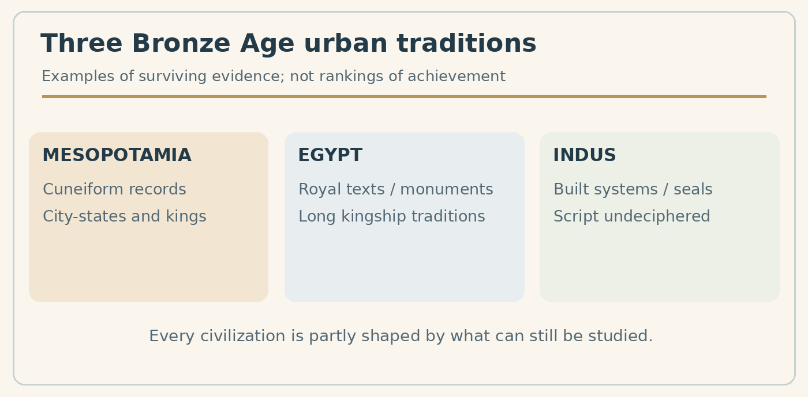

Вече сте се запознали с Месопотамия, Египет и цивилизацията на Инд. Всеки от тях предлага поразителни примери за урбанизъм от бронзовата епоха, специализирана работа, мрежи от разстояние и сложни институции. Изкушението е да попиташ кой е бил "най-напреднал." Въпросът звучи сравнително, но често прикрива неопределена мярка: напреднала в какво и за кого? Монументални кралски гробници, административни таблети, водно инженерство, търговски мрежи и очевидно социално разнообразие измерват различни неща. Империята, която пише много надписи за победа, е по-лесна за описване политически, не автоматично по-сложна от цивилизация, чиято оцеляла писменост не може да бъде прочетена.

<figure class="figure" id="figure-13-12">

<figcaption>Фигура 13.12. Различните видове оцелели източници правят някои въпроси по-лесни за отговор от други. <a class="figure-anchor" href="#figure-13-12" aria-label="Link to this figure">#</a></figcaption>
</figure>

Месопотамските градове-държави генерираха големи органи от административни и литературни текстове, които бяха дешифрирани. Египет построил трайни традиции на териториалното царство и монументално кралско представяне. Светът в Инд е разработил широкообхватни културни конвенции в градския дизайн, управлението на водите, тежестите, тюлените и занаятчийската продукция, като същевременно оставя политическите и религиозни институции по-трудно да се реконструират. Всяко сравнение носи източник асиметрия: където писмените записи оцеляват, историците могат да разказват истории за имена на хора; където те не, ние трябва да позволим материалните модели да вършат повече от работата.

Полезно сравнение от три части пита: Какви екологични възможности и рискове са изправени пред всеки регион? Какво доказателство идентифицира системите за координация? Кое е най - важното ограничение в това доказателство? За Месопотамия писмените архиви могат да надделеят над длъжностни лица и храмове. За Египет елитните паметници могат да представят кралски идеали. За Инд, физическата инфраструктура често оцелява без да може да се чете самоописание. И тримата изискват кръстосана проверка срещу домакинствата, погребални практики, пейзажи и дългосрочни промени.

Сега трябва да видите защо Knowledge Kingdom започна с глави за доказателства, статистика и системи преди да премине към ранни цивилизации. Комплексните общества не се обясняват с една река, един изобретател, един владетел или едно бедствие. Те са исторически отношения между хора, технологии, среди и институции, а доказателствата за тези взаимоотношения са неравномерни.
