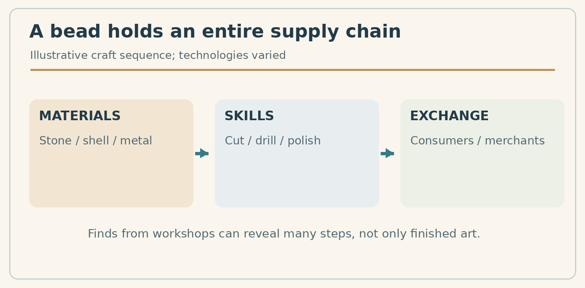

Едно мънисто не по-голямо от върха на пръста може да съдържа часове опитен труд и дълга история на размяна. Харапански занаятчии са работили с камъни като карнелия и агейта, черупка, мед и бронз, злато, керамика и огнени материали, включително фаянс. Правенето и пробиването на твърди камъни изисква практикувани техники, подходящи инструменти, както и познаване на топлинната и повърхностната обработка. Артефакти и работилница остават на обекти като Harappa и Chanhu-daro показват специализирано производство и мрежи, свързващи суровини с готови стоки. \[<a href="/013-the-indus-valley-civilization/sources/#source-10" class="cite">10</a>\]\[<a href="/013-the-indus-valley-civilization/sources/#source-18" class="cite">18</a>\]

Какво ни казва специализацията? Когато някои домакинства или работилници инвестират време в производството на предмети за други хора, те зависят от достъпа до храна, гориво и обмен. Специалистът по занаята може да бъде независим, да работи за институция, да принадлежи към семейна традиция или да работи под патронажа. Инструментите сами по себе си не разкриват трудовия договор. Въпреки това доказателствата сочат към уменията, разпространени сред много хора, а не към цивилизация, изградена единствено чрез анонимни заповеди от въображаем дворец.

Памуковият текстил е важна част от южноазиатската технологична история, въпреки че платът обикновено оцелява слабо в археологическите находища. Археолозите загатват използването на влакна от редки материални следи, впечатления, инструменти и свързани с тях доказателства. Погибелните стоки създават "оцеляващи пристрастия," които могат да направят праисторическата икономика да изглежда по-зависима от камъка, тухлите и метала, отколкото всъщност е била. Липсата на красив запазен текстил в музеен случай не е доказателство, че хората не тъкат всекидневна материя.

<figure class="figure" id="figure-13-8">

<figcaption>Фигура 13.8. Завършен мънисто зависи от материали, техника и социален обмен. <a class="figure-anchor" href="#figure-13-8" aria-label="Link to this figure">#</a></figcaption>
</figure>

Следва един практичен урок. Когато се възхищавате на бронзов инструмент или декориран печат, попитайте какво се крие зад него: познаване на материалните свойства; източник на суровини; инструменти и гориво; производствена последователност; транспорт; потребители и ремонт. Завършен обект компресира веригата за доставки. Ето защо индустриалните и търговски теми на по-късните глави на Knowledge Kingdom вече имат дълбоки корени в археологията.
