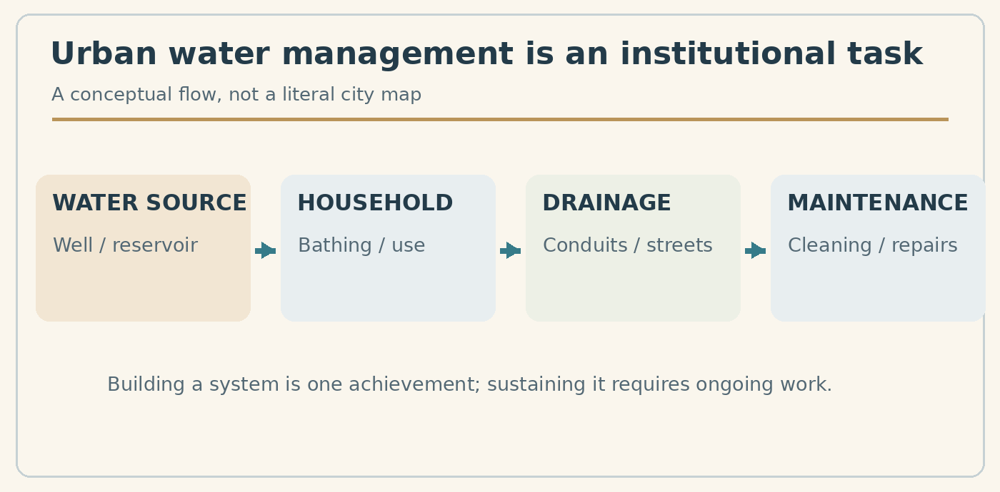

Мохенджо Даро, в Синдх днес в Пакистан, остава едно от най-известните места. Неговите значителни тухлени сгради, улици, кладенци, платформи за къпане и дренаж функции са го направили траен образ на урбанизма в Инд. Възвишеният сектор, традиционно описан като "цитадела" и районите в долната част на града, показва диференцирани пространства, но ние трябва да бъдем внимателни относно прехвърлянето на военните и политическите значения на думата цитаделата във всяка сграда, която тя нарича. Археолозите използват етикети, за да организират обекти и тези етикети понякога са по-уверени от познанието ни за древните функции. \[<a href="/013-the-indus-valley-civilization/sources/#source-2" class="cite">2</a>\]\[<a href="/013-the-indus-valley-civilization/sources/#source-11" class="cite">11</a>\]

Голямата баня е една от най-запомнящите се характеристики: голям тухлен басейн, построен с внимание към контролирането на водата. Мащабът и строителството му предполагат важно колективно предприятие. Тя може да има церемониално значение, но идентифициране на ритуала, участниците, или божествеността, участващите отива отвъд това, което само неговата физическа форма може да установи. "Подобно използван за специална колективна или церемониална цел" е по-защитено твърдение, отколкото да твърдиш, че познаваш напълно изгубена религия. \[<a href="/013-the-indus-valley-civilization/sources/#source-2" class="cite">2</a>\]\[<a href="/013-the-indus-valley-civilization/sources/#source-4" class="cite">4</a>\]

<figure class="figure" id="figure-13-3">

<figcaption>Фигура 13.3. Опростена система за водоснабдяване, използване, дренаж и поддръжка в древен град. <a class="figure-anchor" href="#figure-13-3" aria-label="Link to this figure">#</a></figcaption>
</figure>

Домашните водни системи са не по-малко интересни от прочутата баня. Разкопките разкриват кладенци, бани и канали, обслужващи множество домакинства и улици. Управление на отпадъчните води изисква дизайн, поддръжка и правила, уреждащи споделени пространства; красивата тухлена дренаж става безполезна, ако никога не се почиства. Но съществуването на обширен дренаж не означава, че всеки жител се е радвал на еднаква хигиена или че градът отговаря на съвременните стандарти за обществено здраве. Градът може да бъде впечатляващ и неравен, технически изобретателен и екологично уязвим, внимателно планиран и постоянно реконструиран. \[<a href="/013-the-indus-valley-civilization/sources/#source-11" class="cite">11</a>\]

Има и урок по опазване. Мътните тухли, ерозията, солите и смяната на подземните води усложняват това, което е оцеляло. Разкопаното тримесечие не е непременно представително за всяко тримесечие, а броят на кладенците, видими в изкопните райони, не може да бъде преобразуван в точна популационна цифра с просто съотношение. Най-добрата историческа реконструкция започва с възхищение към инженерството, след това пита какво всъщност е било наблюдавано и какво остава извън разкопаната зона.
