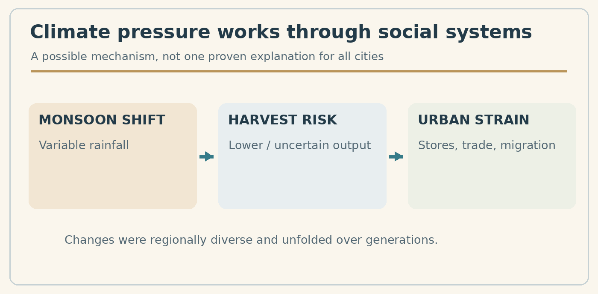

За да се разбере по-късно Харапан свят, започнете с факта, че околната среда не е статично фон. Речната система на река Инд носи огромни седиментни товари; реките променят курса си, наводненията с различна интензивност и преобразяват земята. Сезонните мусонни валежи влияят на възможностите за отглеждане на култури и водните доставки по различен начин в региона. Изследователите изучават древни седименти, форми на земята, изотопи, археологически дати и променящи се разпределения, за да възстановят тези истории. Всяка форма на доказателства отговаря на различен въпрос и има свои собствени ограничения. \[<a href="/013-the-indus-valley-civilization/sources/#source-6" class="cite">6</a>\]\[<a href="/013-the-indus-valley-civilization/sources/#source-7" class="cite">7</a>\]\[<a href="/013-the-indus-valley-civilization/sources/#source-20" class="cite">20</a>\]

Случаят с древните канали в района на Гагар-Хакра е особено поучителен. Геологическата работа показва, че река Сутлех е променила курса си много преди зрялата градска фаза на Харапан в части от системата. Това означава, че е опасно да се загатне масивна течаща река, хранена с ледници по времето на градовете, само защото съществува широк изоставен канал. Някои зони за селище може да са разчитали на сезонни мусонови водни пътища и достъпни подземни води. Геологическата история и археологическата история трябва да се сравнят хронологично, а не само визуално. \[<a href="/013-the-indus-valley-civilization/sources/#source-7" class="cite">7</a>\]

<figure class="figure" id="figure-13-10">

<figcaption>Фигура 13.10. Предлаган път от водоустойчивост до градски стрес, без нито една доказана причина. <a class="figure-anchor" href="#figure-13-10" aria-label="Link to this figure">#</a></figcaption>
</figure>

Много проучвания свързват променящите се мусонни модели и наличието на вода с реорганизирането на селищата в Харапан, но се обсъжда точното регионално време, силата на ефектите и взаимодействието със социалните решения. Вероятен механизъм е, че намаляващата или по-малко предвидима вода намалява надеждността на селскостопанския излишък в някои райони, което прави големите, високо специализирани градове по-трудни за поддържане. Но една крива на климата не определя кой е мигрирал, кой е останал или защо определени институции са престанали да функционират. Изменението на климата оформя варианти; човешките общности все още вземат решения сред тях. \[<a href="/013-the-indus-valley-civilization/sources/#source-6" class="cite">6</a>\]\[<a href="/013-the-indus-valley-civilization/sources/#source-20" class="cite">20</a>\]

Можем да използваме опростен модел на риска, за да видим защо повтарящите се шокове имат значение. Да приемем, че запасите от храна в града обикновено покриват 18 месеца скромно търсене. Една лоша реколта може да бъде управляема, ако резервите и външната обмяна останат на разположение. Три лоши реколтата в рамките на пет години, съчетана с прекъсвания на търговията и миграция, може да изтощи този буфер без един катастрофален ден. Числата тук са измислени за преподаване, но логиката обяснява как постепенното въздействие върху околната среда може да доведе до обща институционална промяна.
