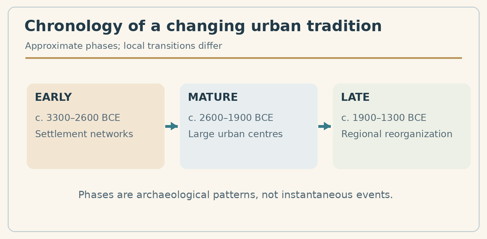

Историците често разделят историята на Харапан на ранни, зрели и късни фази. Широката хронология в класната стая поставя периода на ранния Харапан около 3300.00 BCE, градската фаза на зрелите харапанци около 2600.1900 г. пр.н.е., както и късния период на Харапана от приблизително 1900 до 1300 г. пр.н.е., като същевременно признава, че различните сайтове и автори използват малко по-различни диапазони. Тези фази описват археологически модели, а не три ключа едновременно обърнати през огромна територия. Някои места се устроиха по - рано, други по - късно, а някои останаха в селските райони. \[<a href="/013-the-indus-valley-civilization/sources/#source-1" class="cite">1</a>\]\[<a href="/013-the-indus-valley-civilization/sources/#source-5" class="cite">5</a>\]

Много преди зрелите градове, общностите в по-широкия регион са отглеждали, пасели, грънчарствали и вземали участие в мрежи за обмен. Мергар, в днешния Балохистан, илюстрира много по-ранна и сложна история на установения живот и производството на храна, но не трябва да третираме всяка черта на по-късното Харапанско общество като неизбежна последица от развитието на този сайт. Векове наред между малките ранни селища и големите градове ставали дума за промяна на културите, домакинските икономики, занаятите, размера на селището и взаимоотношенията между общностите. \[<a href="/013-the-indus-valley-civilization/sources/#source-5" class="cite">5</a>\]\[<a href="/013-the-indus-valley-civilization/sources/#source-8" class="cite">8</a>\]

В самия Харапа разкопките отличават предградията и все повече градските фази. Улиците, занаятчийските райони, строителството на калници и аспектите на администрацията се развиват преди най-разпространеният зрял стил да стане видим. Ключовият урок е, че "възходът на цивилизацията" означава много припокриващи се експерименти от много общности. Никой основател не е трябвало да изобретява дренаж, измерване, градско планиране и социална координация в една забележителна сутрин. \[<a href="/013-the-indus-valley-civilization/sources/#source-9" class="cite">9</a>\]

<figure class="figure" id="figure-13-2">

<figcaption>Фигура 13.2. Широки археологически фази; индивидуални селища се развиват и променят по различно време. <a class="figure-anchor" href="#figure-13-2" aria-label="Link to this figure">#</a></figcaption>
</figure>

Датата около 1900 BCE също се нуждае от грижи. Тя бележи важен преход в широката градска мрежа, не и момент, когато всеки обитател изчезва. Следващият въпрос е не само "Защо градовете паднаха?," но "Какво се промени, къде и през колко поколения?" Тази рамка ще има значение, когато изследваме климата и селищните промени в края на главата.
