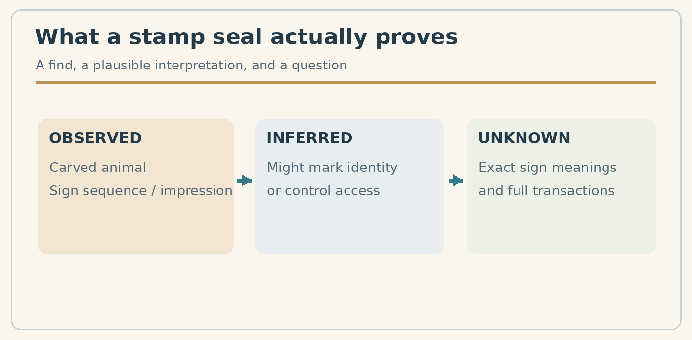

Сред най-разпознаваемите артефакти на Индус са малки, често квадратни тюлени, издълбани от стеатит, относително мек камък, който може да се работи и след това третирани за да стане по-издръжлив. Те обикновено показват животински образ и няколко знака. Някои изобразяват същество, което често се нарича "еднорог," защото е представено в профил с това, което изглежда като един прожектиращ рог; това име описва образа, а не идентификацията на истинско животно или смисъла на изгубен мит. Други тюлени изобразяват бикове, биволи, слонове, носорози и други фигури. Тюлените и техните впечатления се срещат в различни археологически контексти, като някои примери са открити отвъд Индския регион. \[<a href="/013-the-indus-valley-civilization/sources/#source-3" class="cite">3</a>\]\[<a href="/013-the-indus-valley-civilization/sources/#source-14" class="cite">14</a>\]

Тюлените могат да служат на практически и символични функции. В различни древни общества впечатлението за печат може да покаже, че пакетът е бил затворен от оторизирано лице или институция или че дадена стока е била свързана с определена идентичност. Но това би било скок да се твърди, че всеки печат Indus е бил използван за точно една такава цел. Някои биха могли да бележат собствеността, членството, офиса, размяната, религиозните ангажименти или комбинациите от тях. Не можем да прочетем надписите, за да решим въпроса. \[<a href="/013-the-indus-valley-civilization/sources/#source-3" class="cite">3</a>\]

<figure class="figure" id="figure-13-6">

<figcaption>Фигура 13.6. Отделете това, което един печат показва от това, което историците могат да загатнат и все още не могат да превеждат. <a class="figure-anchor" href="#figure-13-6" aria-label="Link to this figure">#</a></figcaption>
</figure>

Представете си да откриете три печата върху глинени фрагменти около една и съща складова стая, след което да възстановите друг пример близо до работилница за занаяти. Многократното използване в сигурни условия може да започне да подкрепя хипотезата за система за организиране на стоки. Но дори и тогава, "този печат помогна да се управлява пратка" би било функционално заключение, а не превод на знаците. За да се провери хипотезата, изследователите ще попитат къде са открити пломбите, как са били направени впечатленията, дали стоките или контейнерите са били наблизо и дали подобни модели се срещат на други места. Скромният артефакт става важен, защото свързва визуалната култура, воденето на записи и икономическото доверие.

Важно е също така да не бъркате атрактивен обект с обяснение на цяло общество. Сниманият печат "еднорог" може да пътува чрез онлайн дебати относно религията или етническата принадлежност, но значението му зависи от това къде е бил намерен и по-голям набор от сравними находки. Без контекст читателят лесно може да изгради история от едно поразително изображение и да пренебрегне стотици по-тихи предмети.
