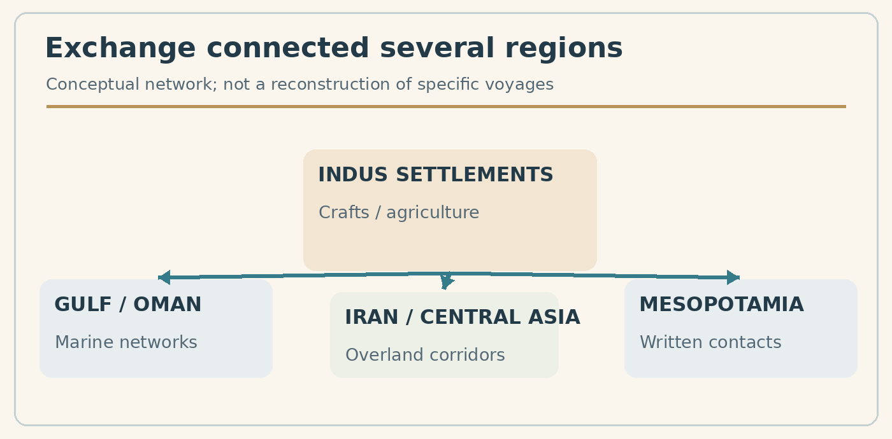

Индските селища са свързани с отдалечени мрежи. Археологическите доказателства включват материали, чиито източници са далеч от градовете, артефакти, открити извън региона, и споделени форми, които предполагат постоянен контакт. Южноазиатски стоки и дизайни взаимодействат с общности в Иранското плато, Афганистан, Оман, Залива и Месопотамия. Месопотамските текстове споменават далечно място, наречено Мелуха, често, но не и без интерпретативни въпроси, свързани с културната сфера на Инд. \[<a href="/013-the-indus-valley-civilization/sources/#source-4" class="cite">4</a>\]\[<a href="/013-the-indus-valley-civilization/sources/#source-14" class="cite">14</a>\]\[<a href="/013-the-indus-valley-civilization/sources/#source-19" class="cite">19</a>\]

Морският маршрут от бронзовата епоха не е бил древна версия на днешната глобална контейнерна флота. Моряците плавали по променящите се крайбрежни води, сезонни ветрове и пристанища с различен капацитет; стоките минавали през посредници и един обект можел много пъти да сменя ръцете си, преди да пристигне в града. Крайбрежните и вътрешните селища свързват морските пътища със селскостопанските и занаятчийските нинтерланди. Наричането на обект "внос" може да опише неговия материален източник, региона, в който е произведен, или последния търговски партньор; те не винаги са идентични.

<figure class="figure" id="figure-13-9">

<figcaption>Фигура 13.9. Овърленд и морски обмен свързани региони; стрелките показват връзки, а не точни маршрути. <a class="figure-anchor" href="#figure-13-9" aria-label="Link to this figure">#</a></figcaption>
</figure>

Месопотамските записи са ценни, защото могат да се четат, но те не са неутрални свидетели на цялата икономика на Инд. Те осветяват това, което един мезопотамски писател или администратор е избрал да записва и имената на местата, използвани в тази племенна традиция. Те не ни казват какво мисли един търговец от Индия за владетеля на Акадските острови, дали една пратка е подарък или търговски договор в съвременния смисъл на думата, или как всяка размяна е регламентирана в град Харапан. Нуждаем се както от текстовете, така и от археологическите доказателства, за да направим сравнението полезно.

Търговията се свързва с политическата устойчивост. Заселване с достъп до вносни камъни или метали може да зависи от дълги маршрути, които не могат да се контролират. Прекъсванията биха могли да заплашат престижните занаяти, но загубата на партньор в чужбина не би спряла задължително основното производство на зърно. Ефектът зависи от това кои стоки, работници и институции разчитаха на размяната. Това е проблем с мисленето на системите, а не обяснение за политическа промяна.
