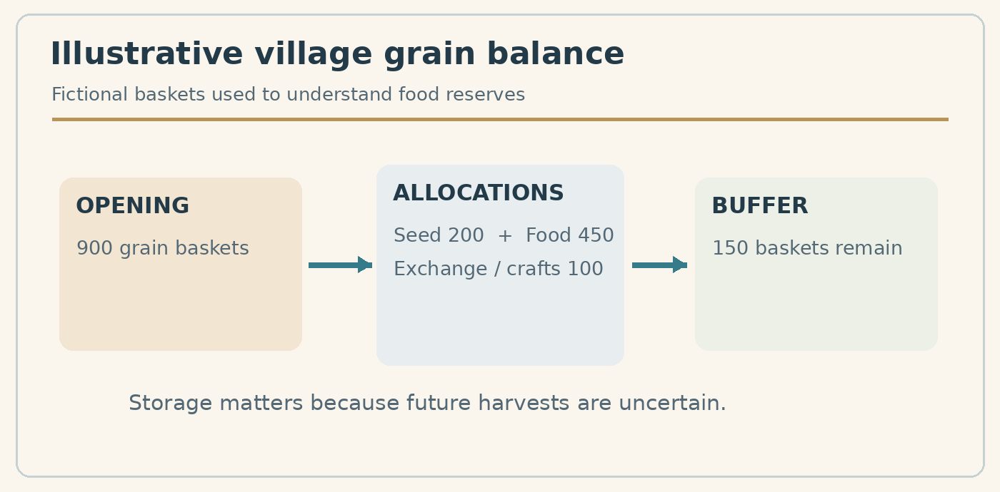

Градовете не са яли тухли. Те зависели от реколтата, стадата, горивата и селскостопанския труд от околните селища. Фермерите отглеждаха култури, включително пшеница и ечемик в много региони, както и други култури, сред които пулсове, семена, орхидеи и ориз на някои места и периоди, които се внасят за регионално разнообразие. Памукът е особено свързан с ранните южноазиатски текстилни традиции, въпреки че индивидуалните твърдения за точен приоритет или размера на производството се нуждаят от внимателна дата и контекст. Едър рогат добитък, овце, кози и други животни подкрепиха различни комбинации от производство, транспорт и работа. \[<a href="/013-the-indus-valley-civilization/sources/#source-5" class="cite">5</a>\]\[<a href="/013-the-indus-valley-civilization/sources/#source-8" class="cite">8</a>\]

Тези модели са варирали в целия огромен регион. Земеделието на наводненията може да бъде полезно, когато реките депозират плодородна утайка и влага. В сухи или мусон-влиятелни райони, избор на култури и засаждане календари се различават. Няма причина да си представяме, че всяко село Харапан е следвало един официален земеделски наръчник. Практическите проблеми бяха познати в различни форми: семената трябваше да бъдат спасени, храната трябваше да достигне населени места, а домакинствата трябваше да оцелеят при сезонна и многогодишна несигурност.

Да разгледаме един чисто хипотетичен пример за счетоводство. Селото съхранява 900 кошници с ечемик. Резервира 200 за семена, 450 за местни домакинства и 100 за занаятчийски работници и обмен; 150 остават като буфер преди загуби. Ако сушата намали следващата реколта наполовина, този буфер може да стане от решаващо значение. Не можем да използваме този измислен пример, за да изчислим действителния данък на Харапан. Можем обаче да го използваме, за да разберем защо съхранението, доверието, транспортирането и мерките за разпределяне на оскъдна храна на всяко голямо селище.

<figure class="figure" id="figure-13-4">

<figcaption>Фигура 13.4. Илюстративно разпределение на зърното; количествата са измислени и не са разкопана сметка. <a class="figure-anchor" href="#figure-13-4" aria-label="Link to this figure">#</a></figcaption>
</figure>

Изборът на домакинство в селските райони също може да ограничи градския живот. Фермерите може да предпочитат гъвкав местен обмен, докато градските администратори търсят стандартизирани доставки; пасторалната мобилност може да не пасне на чистите градски граници; времето може да наруши договорените задължения. Ръстът на градовете изискваше взаимозависимост, а не само налагане на план с права линия върху пасивната провинция.
